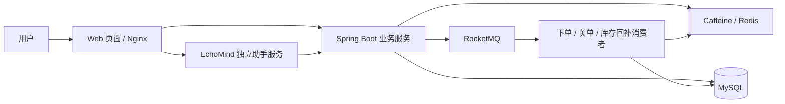

# 智惠生活通 · LocalPerks

一个把附近商铺、探店分享和优惠券放在一起的本地生活平台，基于 Spring Boot、Redis 和 RocketMQ 构建。

你可以在这里找店、看探店笔记、参与优惠券秒杀，也可以关注喜欢的作者，看看他们最近去了哪里。项目还接入了智能助手 EchoMind，让查店、找优惠和查询订单多一个对话入口。

## 能做什么

### 找一家想去的店

按分类浏览商铺，搜索店名，或根据当前位置查找附近的店。商铺列表支持距离、人气、评分等排序，详情页可以查看店铺信息和在售优惠券。

### 看看大家怎么逛

浏览热门探店笔记，发布自己的图文内容，给笔记点赞、发表评论或回复。遇到感兴趣的作者可以关注，在关注动态里继续看他们的新分享，也能查看彼此的共同关注。

### 抢一张优惠券

在商铺详情页参与限时优惠券秒杀，提交后查看排队和下单结果。订单支持支付、取消、核销和退款；未支付的订单会在超时后自动关闭，并回补库存。

支付和退款目前采用模拟实现，方便在本地体验交易流程，尚未对接真实支付渠道。

### 和助手聊聊需求

智能助手页面提供对话、功能入口、专家和记忆四个面板。接入 EchoMind 后，可以通过对话查询商铺、优惠券和订单，并结合个人偏好继续交流。涉及抢券、支付、取消等操作时，会先展示确认卡片，由用户确认后执行。

EchoMind 是独立服务。本仓库提供助手前端和 Nginx 接入配置，助手后端需要另外部署。

此外，项目支持手机验证码登录、个人资料编辑、每日签到和连续签到统计。当前验证码输出到后端开发日志，未接入短信服务。

## 关键设计

本地生活平台既有大量的商铺浏览，也有抢券时集中的交易请求。项目围绕这两类访问，以及后续的订单处理，做了以下设计。

### 商铺查询：让重复访问尽量走缓存

商铺详情优先读取 Caffeine 本地缓存，再查询 Redis，最后访问 MySQL。对不存在的商铺 ID，使用布隆过滤器和空值缓存减少无效数据库查询；布隆过滤器不可用时回退到常规查询。商铺信息更新后，在数据库事务提交后清理缓存，并通知其他实例清理本地缓存。

附近商铺使用 Redis GEO 按距离检索。登录态、签到、点赞和关注关系也分别使用 Redis 的不同数据结构处理。

### 优惠券秒杀：先受理请求，再异步生成订单

默认模式下，Redis Lua 原子检查库存和一人一单资格，RocketMQ 事务消息将库存预扣与下单消息关联起来，消费者再异步写入 MySQL。消息重复投递时，通过订单主键和用户、优惠券唯一索引避免重复创建订单。

项目也提供消费端扣库存模式，可通过 `SECKILL_MODE=B` 切换：入口负责排队和发送消息，库存与资格由消费者认领。两种模式用于比较不同的请求处理方式，默认使用 `A`。

### 订单处理：取消之后，库存也要跟上

支付、取消、核销和退款通过订单状态校验控制流转，支付与超时关单并发时使用条件更新处理竞争。

取消或超时关闭订单时，MySQL 库存回补和回补事件在同一事务中保存。后台通过 RocketMQ 投递事件，由 Lua 去重后回补 Redis 库存；发送或消费失败可以重试。定时对账用于发现库存差异，并补充处理遗漏的超时订单。

这条链路采用至少一次投递与业务幂等，详细机制见[库存回补说明](docs/stock-restore-outbox.md)。

### 智能助手：连接业务，也保留用户确认

接入的 EchoMind 服务支持工具调用、多专家协作、上下文压缩和按用户保存长期记忆。助手可以按需查询平台规则，或将检索任务交给导购、内容推荐和订单专家，再汇总回答。前端通过 SSE 展示流式回复和执行进度，写操作统一经过用户确认。

## 系统结构



## 技术栈

| 层次 | 技术 | 用途 |
| --- | --- | --- |
| 后端 | Java 8、Spring Boot 2.3.12、MyBatis-Plus 3.4.3 | 业务接口、数据访问、事务处理 |
| 数据与缓存 | MySQL、Redis 6.2+、Caffeine、Redisson | 业务数据、多级缓存、GEO 检索、登录态与并发控制 |
| 消息队列 | RocketMQ 4.9.x | 异步下单、事务消息、延迟关单、库存回补 |
| 前端 | Vue、Element UI、HTML / CSS / JavaScript | 商铺、社区、订单和助手页面 |
| 接入 | Nginx、SSE | 静态资源、API 反向代理、助手流式响应 |

## 本地运行

### 1. 准备环境与数据库

需要 JDK 8、Maven 3、MySQL、Redis 6.2+、RocketMQ 4.9.x 和 Nginx。前端依赖随仓库提供，无需额外执行 npm 构建。

创建 `hmdp` 数据库，按顺序导入以下脚本：

| 脚本 | 内容 |
| --- | --- |
| [hmdp.sql](src/main/resources/db/hmdp.sql) | 基础表与示例数据 |
| [V2__trade.sql](src/main/resources/db/V2__trade.sql) | 交易字段、唯一索引与库存对账字段 |
| [V3__comment.sql](src/main/resources/db/V3__comment.sql) | 评论相关表 |
| [V4__stock_restore_outbox.sql](src/main/resources/db/V4__stock_restore_outbox.sql) | 库存回补事件表 |

`hmdp.sql` 会重建同名表，请在新建的开发库中导入。项目不会自动执行数据库迁移，以上脚本需要在启动前完成。

### 2. 启动 Redis 与 RocketMQ

启动 Redis，再启动 RocketMQ 的 NameServer 和 Broker。仓库提供了 Windows 启动脚本，使用前需要设置本机 RocketMQ 安装路径，具体见 [RocketMQ 启动说明](deploy/rocketmq/README.md)。

分别在两个终端中运行：

```powershell
.\deploy\rocketmq\start-namesrv.cmd
```

```powershell
.\deploy\rocketmq\start-broker.cmd
```

### 3. 配置并启动后端

参考 [.env.example](.env.example)，在终端或 IDE 中设置环境变量。应用不会自动读取 `.env` 文件。

在项目根目录执行，下面以 PowerShell 为例：

```powershell
$env:DB_USER = 'root'
$env:DB_PASSWORD = '填写本机数据库密码'
$env:DB_URL = 'jdbc:mysql://127.0.0.1:3306/hmdp?useSSL=false&serverTimezone=UTC'
$env:REDIS_HOST = '127.0.0.1'
$env:REDIS_PORT = '6379'
$env:ROCKETMQ_NAME_SERVER = '127.0.0.1:9876'
# Redis 开启认证时，还需设置 REDIS_PASSWORD。
mvn spring-boot:run
```

后端默认监听 `8081` 端口。未支付订单默认在 30 分钟后关闭，相关参数见 [application.yaml](src/main/resources/application.yaml)。

### 4. 启动前端

单独安装 Nginx，使用仓库中的配置与静态资源。以下命令中的可执行文件路径需要替换为本机安装路径：

```powershell
New-Item -ItemType Directory -Force nginx-1.18.0/logs, nginx-1.18.0/temp
& 'D:/tools/nginx/nginx.exe' -p "$PWD/nginx-1.18.0/" -c conf/nginx.conf
```

浏览器打开 [http://localhost:8080](http://localhost:8080) 即可访问。Nginx 将业务请求转发到 `8081`；助手页面位于 [/chat.html](http://localhost:8080/chat.html)，默认通过 `/cs-api` 连接本机 `18080` 端口的 EchoMind 服务。

图片默认保存到 `nginx-1.18.0/html/hmdp/imgs`，可通过 JVM 属性 `hmdp.image-upload-dir` 修改。体验附近商铺前，可运行 `HmDianPingApplicationTests.loadShopData`，将开发库中的商铺坐标导入 Redis GEO。

## 目录结构

```text
local-perks/
├── src/main/java/com/hmdp/     # 业务接口、服务、缓存与消息处理
├── src/main/resources/        # 配置、SQL 和 Redis Lua 脚本
├── src/test/                  # Java 单元测试与集成测试
├── nginx-1.18.0/
│   ├── conf/                  # Nginx 配置
│   └── html/hmdp/             # 业务前端与智能助手页面
├── deploy/rocketmq/           # RocketMQ 本地启动配置
├── tests/                     # 浏览器回归与压测工具
├── docs/                      # 补充设计与维护文档
├── .env.example               # 环境变量示例
└── pom.xml
```

## 补充说明

商铺和优惠券管理接口已有管理员校验，商家角色、门店归属与真实商家核销仍需进一步完善。智能助手的语音、多模态与外部知识库接入也不在当前实现范围内。

构建使用 `mvn -DskipTests package`。回归测试与压测工具见[测试说明](tests/README.md)，其中集成测试需要独立的 MySQL、Redis 等依赖环境。
