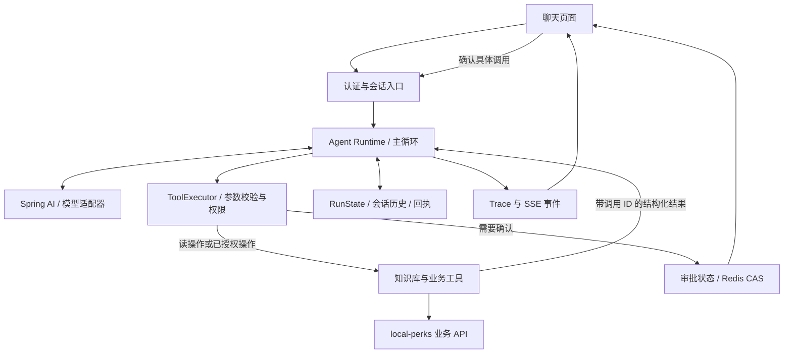

# LocalPerks Agent 下一阶段设计与实施路线

日期：2026-10-17。本文是源码核对后的设计建议，尚未实施其中的改造。

## 1. 结论与实际基线

继续使用独立的 EchoMindJava 服务，在现有手动 Agent Loop 上建设可靠的业务运行时。下一里程碑是：用户能在对话中查询真实店铺和优惠券，经本人确认发起一次抢购，并查询异步订单的真实结果；重复确认、服务故障、刷新页面和后续追问都有明确行为。

参考材料分工：

- `learn-claude-code-main/claude-code-main/src`：本地 Claude Code 源码快照，作为循环、工具契约、权限、执行、上下文管理的主要对照。
- `learn-claude-code-main/s01…s17`：教学实现，帮助理解和分步练习。课程中的所有扩展不必一次移植。
- 用户指定 ZIP 内 EchoMindJava：复用 Java 工程、RAG、记忆、技能文件、监控和 API。原版 `BaseAgent.handle()` 主要是一次文本模型调用。
- ZIP 内 Python EchoMind：参考工具校验、调用成功与业务成功的区分、会话锁、原子提交和请求回执；按 Java 工程重新实现需要的机制。
- 前置学习笔记：JavaSE、MySQL、Spring/MVC/AOP、HTTP 客户端、ThreadLocal、Redis/Lua/Redisson 已有学习材料。掌握程度以能解释并独立验证为准。
- `.workbuddy/memory`：用于恢复开发决策和验证记录。它是开发资料，不应作为面向终端用户的客服知识库输入。

当前已实现并在源码确认：

1. `AgentLoopRunner` 手动循环，设置 `internalToolExecutionEnabled(false)`；默认最多 5 次模型调用，工具结果按调用 ID 回填。
2. 6 个工具：`search_knowledge`、`search_shop`、`get_shop`、`list_vouchers`、`list_my_orders`、`seckill_voucher`。
3. Redis 保存待审批消息，`/chat/approve` 恢复；聊天页已经调用 `/chat/agent` 并展示确认按钮。
4. 已有 Redis 会话记忆、基于条数的摘要压缩、用户画像及 Skills 文件热加载。

验证范围必须修正：10 月 16 日 23:40 的记录显示，知识问答、业务服务不可用时的错误处理、审批与取消流程验证通过；当时 local-perks 8081 未启动，真实查店、查订单和抢购成功链路未验证。当前结论来自源码和历史记录，本次未启动服务或调用写业务接口。

## 2. “遵循 Claude Code 源码”的具体映射

| 本地源码机制 | Java 落点 | 下一步 |
| --- | --- | --- |
| `src/query.ts`：消息驱动循环、终止、取消 | `AgentLoopRunner` | 保持循环小而稳定；持久化预算、执行位置和停止原因 |
| `src/Tool.ts`：schema、validateInput、权限、只读与并发属性 | `ToolRegistry` + 工具描述对象 | 在 `ToolCallback` 外补业务元数据与执行约束 |
| `services/tools/toolExecution.ts`：解析、校验、hooks、权限、执行和结果 | 新增 `ToolExecutor`、`PermissionGate` | 每条调用统一走执行器，恢复路径也走同一条链路 |
| `services/tools/toolOrchestration.ts`：按并发安全性分组执行 | 执行器内的调度策略 | 初版顺序执行；以后仅并行明确独立且安全的读调用 |
| `tools/SkillTool/SkillTool.ts`：通过工具加载技能 | 扩展 `SkillManager` + `load_skill` | 首屏注入名称和用途，模型按需加载正文 |
| `services/compact/*`：工具结果预算和上下文压缩 | `ContextManager` | 保持调用与结果成对，先限制结果体积，再摘要较早历史 |
| 消息与工具生命周期事件 | `AgentEventSink`、Run/Trace 存储、SSE | 同一套事件支持页面进度、诊断、恢复和评测 |

对齐的是这些可检验的行为与边界。业务领域中，模型选择查什么、组合哪些工具；库存原子扣减、订单权限、状态转换和支付规则继续由 local-perks 的确定性代码负责。

Spring AI 1.1 官方文档明确支持调用方控制执行循环。保留当前版本与手动执行方式；实现时使用 1.1 对应 API，避免混用新主版本示例。

## 3. 现有代码中应先处理的问题

以下是静态阅读发现，尚未通过运行测试复现。

| 优先级 | 证据与行为 | 应如何处理 |
| --- | --- | --- |
| P0 | `AgentLoopRunner.resume()` 按工具名称匹配审批，随后遍历执行最后一条 assistant 消息中的全部调用。同一批两个抢券调用可能被一次确认放行 | 审批绑定 `runId + toolCallId + 规范化参数摘要 + 用户`；每个写调用分别授权，逐项恢复，保留已执行结果 |
| P0 | 审批状态 `load()` 后 `delete()`，双击确认可并发读到；执行前删除也会丢失失败后的恢复线索 | Lua/CAS 原子抢占执行权，保留状态与结果回执；过期和重复确认返回明确状态 |
| P0 | `/chat/agent` 使用请求体的 `user_id` 选择记忆；`/chat/approve` 未绑定当前认证主体 | 服务端根据有效登录态解析身份，校验会话与审批归属；游客使用服务端签发的独立会话标识 |
| P0 | 当前超时只在轮次开始检查；同步模型调用与 HTTP 请求可能长时间阻塞 | 配置模型、连接、读取和单工具超时；传播取消信号，所有步骤受剩余执行预算约束 |
| P0 | `execute()` 只要 callback 不抛异常就记录成功，而 HTTP 客户端会将业务失败转成普通文本 | 统一 `ToolResult`，分别记录调用是否完成、业务状态、是否可重试、证据与错误码 |
| P0 | 秒杀工具把接口受理成功包装成“抢购成功”；业务订单实际异步创建 | 返回 `ACCEPTED/PENDING`，增加归属校验后的订单结果查询；只有查询确认落库才能表述下单成功 |
| P1 | `/chat/approve` 没有完成轮次的记忆提交，返回的 request_id 为 null；现有 trace 查询仍指向旧 orchestrator | 两个入口共享最终提交路径，沿用同一 run/request ID，记忆、回执和 trace 一致提交 |
| P1 | 工具去重使用原始参数字符串，执行前记入集合；失败读调用也被阻止再次执行，重复调用只返回“跳过” | 区分循环检测、读结果复用与写幂等；读失败允许有预算的重试，写操作依靠持久化操作键和业务幂等 |
| P1 | `MemoryManager.compress()` 先读后删再写，可能覆盖并发新增消息；保留消息的重建顺序也需回归验证 | 用版本号/快照校验提交压缩结果，完整轮次原子追加；压缩失败保留原文，验证时间顺序 |
| P1 | 新工具链的 `SkillManager.promptFor()` 仍按规则匹配并拼接正文 | 改为目录 + `load_skill`；规则可以提供候选信息，实际工具选择留给模型 |

审批原子抢占只能解决并发执行权，不能单独保证跨服务副作用“恰好一次”。若 HTTP 超时但业务可能已成功，要记为 `OUTCOME_UNKNOWN`，查询业务结果或等待人工处理，不自动重复发起写调用。

## 4. 目标架构

建议在现有 `com.echomind.toolcall` 下逐步抽取职责，保留可运行入口：

- `runtime`：循环、模型适配、预算、取消、RunState。
- `tool`：工具注册、描述、校验、执行、结构化结果；沿用 Spring AI 的 schema 与 callback 能力。
- `permission`：登录身份、工具策略、审批记录和恢复。
- `session`：会话归属、单轮提交、请求回执、摘要和上下文。
- `event`：执行事件、trace、SSE 输出。
- `business`：现有 LocalPerksClient/Tools，负责调用业务 API。

先抽取确有多处调用的执行器与状态服务。无需为了目录结构改动所有现有类。

身份和 token 通过不可由模型提供的执行上下文传递；使用显式 `ToolContext` 或等效参数。当前 ThreadLocal 适合同线程链路，增加 SSE、线程池或读工具并行时必须显式传播身份。

工具结果建议包含 `toolCallId`、`callStatus`、`businessStatus`、`data`、`errorCode`、`retryable`、`observedAt` 和来源。检索结果、店铺文本与历史记忆作为数据处理，不拥有改变权限策略的能力。

运行状态建议：`RUNNING → WAITING_APPROVAL → RUNNING → COMPLETED/FAILED/CANCELED`。审批等待时间独立于执行预算；恢复保留已耗预算。多个待执行调用记录游标与各自结果，不重放已成功的写调用。

## 5. 按验收结果推进的四个里程碑

### M1：可靠执行器 + 一条真实业务闭环（立即开始）

实施顺序：

1. 保存两套工程当前源码和依赖版本，确认 local-perks 新版可构建、数据库增量已正确应用、Redis/MySQL/RocketMQ 可用。使用隔离测试数据；先跑普通 API。
2. 用脚本化模型响应构造测试：单轮两个写调用、确认其中一个、拒绝其中一个、重复确认、其他用户确认、过期审批、业务失败返回值、工具超时。
3. 修复逐调用审批、原子状态转换、身份绑定、显式工具结果、超时和请求回执。
4. 补 `get_order_status` / 必要的订单详情工具，先修后端状态查询的订单归属校验。所有订单 ID 使用字符串贯穿 JSON 与页面。
5. 打通“搜索店铺 → 查询优惠券 → 本人确认 → 发起抢购 → 查询异步结果 → 展示订单”。

审批卡片应展示店铺、券名、价格和操作含义，并绑定用户看到的参数快照；执行时重新校验有效性。价格等关键内容变化时重新确认。规则、库存和成功状态来自业务接口。

验收：同一审批最多被一个执行者取得；未批准的调用没有副作用；同一用户重试能得到已有结果；未知执行结果不会被报告为成功或自动重放；多轮追问能接续确认后的结果。

测试也应覆盖底层库存与事务边界，包括重复消息、支付与关单并发、对账期间下单。Agent 的幂等不能替代业务服务的正确性。

### M2：执行过程可见 + Skills 按需加载

- 增加 SSE 输出：`run_started`、`tool_started`、`tool_result`、`approval_required`、`text_delta`、`run_completed`、`run_failed`。
- 先有真实的工具阶段事件，再对模型正文使用流式 API；工具参数必须收齐并校验后才执行。
- 页面通过带身份信息的 POST/fetch 接收流，支持取消；重连查询原 run，不能重连即重跑业务。
- 保存并恢复 conversationId，刷新不应自动创建全新对话。
- 将技能加载改为“目录摘要 + load_skill(name)”；保留通用客服规则，按需加载优惠券/订单、商铺推荐等业务指南。
- 展示工具动作和结果摘要，不把模型内部思考作为产品依赖。

验收：用户能区分查询、待确认、等待订单与最终结果；确认后无需丢失前文；未使用的技能正文不占模型上下文；断开页面不会造成重复写入。

### M3：上下文与记忆可靠化

- 区分运行中的完整消息日志、用于模型的上下文窗口、用于以后会话的稳定偏好，以及实时业务状态。
- 当前已有普通对话摘要，重点补工具消息预算、调用/结果成对保存、待审批状态保留、历史原子提交及压缩并发控制。
- 上下文先做字段筛选、结果数量限制和旧工具结果压缩，再摘要旧轮次；必要时可从有访问控制的记录读取详情。
- 记忆保留用户偏好与带时间来源的摘要。库存、券价格、订单状态再次使用时查询业务接口。
- 基础 RAG 继续复用。当前 Java 检索包含 BM25 与本地哈希向量，不应把它表述为已接通专业 embedding 检索；只有评测显示检索不足时再换 embedding/向量存储。

验收：长对话不破坏工具调用协议；压缩与新增请求并发时不丢消息；审批后追问能够回答正确；不同用户不会读到彼此记忆。

### M4：评测与展示材料

先建立约 30 条固定业务场景，作为建议起始规模：规则问答、查店查券、订单查询、审批、故障和多轮追问。固定数据、输入和预期断言，保留版本化结果。

- 确定性测试：脚本化模型返回工具序列，验证运行时约束；不依赖真实 LLM 的随机性。
- 真实模型回归：验证选工具、参数、来源和最终答案；与运行时测试分开报告。
- 指标：任务完成率、工具选择/参数正确率、未授权副作用次数、重复副作用次数、错误状态误报率、首事件耗时、完整耗时和 token 用量。
- 单独记录审批等待与实际执行耗时，避免混入延迟统计。
- 对比每次改动前后的同一批用例，保留 trace 与失败分类。简历只写实测结果。

## 6. 学习安排与范围

| 已有笔记中的基础 | 直接映射到本阶段 | 需要补充的内容 |
| --- | --- | --- |
| Java 接口、集合、注解、反射 | ToolRegistry、ToolExecutor、工具元数据 | JSON Schema、tool_call_id 与消息协议 |
| Spring IoC/AOP/MVC、HTTP 客户端 | 工具 Bean、执行前后扩展点、业务 API | Spring AI 1.1 ToolCallback/ToolContext；显式错误模型 |
| Redis、Lua、分布式锁 | 审批 CAS、会话串行化、回执和 TTL | 执行状态与副作用结果未知时的恢复规则 |
| MySQL 事务、索引、条件更新 | 一人一单、幂等、状态转换 | 跨服务执行不确定性；确认后查验结果 |
| 线程池、ThreadLocal、WebSocket 基础 | 异步输出、取消、上下文传递 | SSE、最小必要的流式处理 API |

学习顺序：`s01/s02 → s03/s04 → s07 → s08/s09`，每学一个机制就落入对应 Java 模块并跑一个验收场景。Java 21 的 record、文本块等语法按现有代码需要补学。

参考简历的可借鉴点：第一份的 Runtime/工具治理/可复现评测，第二份的运行状态/幂等/恢复，第三份的本地生活业务闭环与 Redis 工程能力。其性能数字属于参考材料自述，不作为我们的结果。

首版范围：单主 Agent、有限业务工具、逐调用审批、可靠会话、按需 Skills、SSE 与评测。多 Agent 团队、MCP 动态接入、目标自主续跑、长期后台任务在前述验收通过后按业务需要评估。可选的第一个子 Agent 是只读的多店比较任务，需先证明拆分比单循环有收益。

## 7. 已核对的关键来源

- [当前循环与审批恢复](D:/PyChram_project/Java_learn/Redis/EchoMind参考代码/EchoMindJava/src/main/java/com/echomind/toolcall/loop/AgentLoopRunner.java:80)
- [当前审批存储](D:/PyChram_project/Java_learn/Redis/EchoMind参考代码/EchoMindJava/src/main/java/com/echomind/toolcall/loop/ToolApprovalService.java)
- [当前客服与审批入口](D:/PyChram_project/Java_learn/Redis/EchoMind参考代码/EchoMindJava/src/main/java/com/echomind/api/EchoMindController.java:169)
- [当前会话压缩](D:/PyChram_project/Java_learn/Redis/EchoMind参考代码/EchoMindJava/src/main/java/com/echomind/memory/MemoryManager.java:116)
- [Claude Code 工具契约](D:/PyChram_project/learn-claude-code-main/claude-code-main/src/Tool.ts:394)
- [Claude Code 参数校验与执行](D:/PyChram_project/learn-claude-code-main/claude-code-main/src/services/tools/toolExecution.ts:615)
- [Claude Code 主循环](D:/PyChram_project/learn-claude-code-main/claude-code-main/src/query.ts:219)
- [项目阶段③验证记录](D:/PyChram_project/Java_learn/Redis/local-perks/.workbuddy/memory/2026-10-16.md:178)
- [Spring AI 1.1：调用方控制工具执行与 ToolContext](https://docs.spring.io/spring-ai/reference/1.1/api/tools.html)。关闭内部执行后由应用处理工具消息；ToolContext 数据不发送给模型。
- [Claude Code 官方架构说明](https://code.claude.com/docs/en/how-claude-code-works)。循环根据工具结果继续行动，并由 harness 管理上下文、工具和权限；Skills 按需加载。

ZIP 中核对的路径包括 `EchoMind/agents/agent_orchestrator.py`、`EchoMind/tooling/tool_manager.py`、`EchoMind/memory/conversation_memory.py`、`EchoMind/wiki/教程/07-Agent路由Skills与工具执行.md` 及 Java 原始 `BaseAgent.java`、`pom.xml`。
