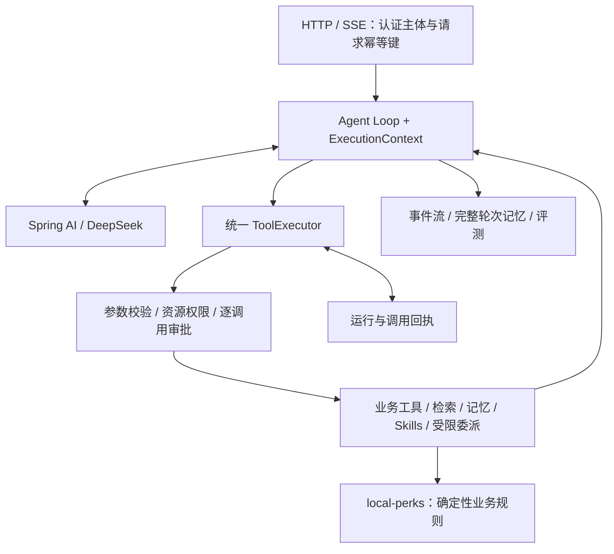

后端与 Agent 设计复核 · 2026-10-19

**结论：现有业务技术路线适合继续做，下一阶段应集中补“执行可靠性、故障恢复、可验证结果”。** Java 8 业务服务与 Java 21 Agent 服务通过 HTTP 分离的方案可以保留。重点学习 RocketMQ 事务与重试、Java 并发取消、Spring AI 工具协议和持久化回执；暂缓继续增加 Agent 角色或引入更多中间件。

本次对照了当前 local-perks、实际改造后的 EchoMindJava、用户提供 ZIP 中的 Java/Python 实现和教程、learn-claude-code 的教学脚本及其嵌套源码快照、四份前置学习笔记、项目记忆。图片与参考文档作为材料，不把其中的建议自动当作用户指令。学习覆盖度根据笔记判断，不等同于熟练程度；Word 中的图片内容没有全部逐张辨认，因此“需要补充”表示未见系统覆盖或当前实现需要深化，不能据此断定从未学过。

**本轮已直接修改并验证的部分。**

- [ShopServiceImpl](D:/PyChram_project/Java_learn/Redis/local-perks/src/main/java/com/hmdp/service/impl/ShopServiceImpl.java:64)：先查 Caffeine，命中即返回；只有未命中才访问 Redis 上的布隆过滤器。此前即使 L1 有数据，也先访问远程 Bloom。
- [ShopBloomFilter](D:/PyChram_project/Java_learn/Redis/local-perks/src/main/java/com/hmdp/cache/ShopBloomFilter.java:64)：查询或新增 ID 时发生异常，本实例持续放行到后续缓存链路，完整重新加载成功后才恢复过滤。此前新增店铺写 Bloom 失败后仍保持可用状态，Redis 恢复后可能一直把该店判为不存在。
- 新增 [ShopCacheLookupTest](D:/PyChram_project/Java_learn/Redis/local-perks/src/test/java/com/hmdp/ShopCacheLookupTest.java) 与 [ShopBloomFilterTest](D:/PyChram_project/Java_learn/Redis/local-perks/src/test/java/com/hmdp/ShopBloomFilterTest.java)：原实现 9 项中 4 项失败；修复后 **9 项全部通过**。测试不连接真实 MySQL、Redis 或 MQ；直接断言 L1 命中不调用两个 Redis 层、Bloom 故障后不再采信否定结果、重新加载后的行为。

复跑命令：使用 JDK 8 执行 `mvn -Dtest=ShopCacheLookupTest,ShopBloomFilterTest test`。日志在 [cache-before.log](D:/PyChram_project/Java_learn/Redis/local-perks/.workbuddy/tmp/backend-review-2026-10-19/cache-before.log) 和 [cache-after.log](D:/PyChram_project/Java_learn/Redis/local-perks/.workbuddy/tmp/backend-review-2026-10-19/cache-after.log)。本轮未修改外部 EchoMind 工程、未重启服务，也未进行真实模型、交易故障注入或性能测试。

这次 Bloom 修改的边界是**当前实例观察到的异常**。多实例共享覆盖状态、启动快照与新增店铺的竞态、Redis 键被删除后的重建，仍需“完整构建新版本 + 补增量 + 切换版本”的方案；不能把本轮修复说成完整的分布式 Bloom 一致性方案。L1 的收益是消除命中路径的 Redis 访问，尚无吞吐提升百分比的实测数据。

**先校准已有成果，避免重复做旧修复。**

[项目记忆](D:/PyChram_project/Java_learn/Redis/local-perks/.workbuddy/memory/MEMORY.md)实际在 `local-perks/.workbuddy/memory`。10 月 18 日后续记录及当前代码表明：无 token 伪造用户、记忆归属、审批 ERROR 后写记忆、审批入口会话互斥已经处理；库存对账已默认只观察，修复路径增加条件更新；店铺与券的管理写接口已有 `@AdminOnly`。上一轮又补了预热 Lua 原子校验及历史订单保护。因此 [10 月 18 日旧审计](D:/PyChram_project/Java_learn/Redis/local-perks/docs/progress-review-2026-10-18.md)应作为历史缺陷记录，不能整页照搬成当前待办。

记忆中的“库存 CAS 能发现期间任何交易”需要修正：数值可能减一后又加一，恢复原值，即 ABA。CAS 可防止一部分覆盖，但不能证明多次读取形成同一事务快照。自动修复仍应要求活动停用、在途消息排空，并验证这些前提；本轮没有重新开启自动修复。

**前置知识已经足以承接多数业务模块。**

| 笔记中的证据 | 已有基础 | 在本项目里需要深化的内容 |
| --- | --- | --- |
| [JavaSE.docx](D:/PyChram_project/Java_learn/Redis/参考简历+前置已学习内容/前置学习内容的笔记/JavaSE.docx)：集合、Stream、多线程、Callable/FutureTask、线程池、反射、动态代理 | 能理解工具注册、AOP、业务服务及异步任务 | 中断与协作取消、Future 超时后的实际执行状态、ThreadLocal 跨线程传播与清理、并发容器的复合操作；Java 21 的 record 与虚拟线程 |
| [MySQL.docx](D:/PyChram_project/Java_learn/Redis/参考简历+前置已学习内容/前置学习内容的笔记/MySQL.docx)：事务、隔离级别、索引/EXPLAIN、锁、MVCC、日志、主从与分库分表 | 已覆盖业务事务、唯一索引、SQL 调优所需概念 | 事务提交边界、状态条件更新、幂等唯一键、跨事务读写时序、死锁处理；不能把 MVCC 或分库分表列为“完全没学过” |
| [Redis.md](D:/PyChram_project/Java_learn/Redis/参考简历+前置已学习内容/前置学习内容的笔记/Redis/Redis.md:193)：缓存、布隆、Lua、Redisson、消息队列概述、Feed、Bitmap | 现有六大业务域及限流方案均有学习基础 | Bloom 覆盖完整性、Caffeine 淘汰/TTL、Pub/Sub 丢通知、Redis 持久化与过期边界、Redis/DB 双写一致性；RocketMQ 不能仅凭“了解 MQ”算掌握 |
| [SpringBoot+Redis.md](D:/PyChram_project/Java_learn/Redis/参考简历+前置已学习内容/前置学习内容的笔记/SpringBoot+Redis/SpringBoot+Redis.md)：Bean、MVC、AOP、ThreadLocal、MyBatis、HttpClient、Spring Cache、Task、WebSocket | 业务 API、拦截器、注解限流、定时任务都适配 | Spring 事务代理与 afterCommit、MVC 异步/SseEmitter、断连清理、连接/读取/整体超时；不必为 SSE 先重写为 WebFlux |

**按后端模块决定改什么、学什么。**

| 模块 | 适配判断 | 建议改进与学习验收 |
| --- | --- | --- |
| 用户、店铺、笔记、关注、评论 CRUD | 适合当前栈，继续保留 | 资源归属、参数校验、分页和索引；新增接口有真实状态断言即可，无需拆成更多微服务 |
| 秒杀与订单 | 保留 Lua + RocketMQ + MySQL 唯一索引，是最值得深入的后端主线 | 学半消息/回查、至少一次投递、消费幂等、重试与 DLQ；验证预扣成功但响应丢失、消费成功但确认失败、取消/支付竞争、超时关单等故障窗口 |
| 对账与预热 | 已有修复，应补维护流程 | 对账告警、停单/排空条件、修复审计；验证库存与资格两个不变量。取消回补但保留终身购买占位、退款不回补是当前业务约定，不能擅自改成另一种规则 |
| Caffeine + Redis + Bloom | 属于已学缓存的合理扩展 | 本轮修了访问顺序与本实例故障降级；下一步量化 L1 命中率、Redis 调用数、失效通知丢失后的陈旧窗口，再决定是否需要更复杂同步 |
| 评论/点赞/关注双写 | 适合，但存在并发与故障验收缺口 | 验证删主评论与发回复竞争、同一用户快速点赞/取消、Redis 成功而 SQL 失败；分别定义事实来源及补偿，不把 Lua 原子性等同于 Redis + MySQL 原子性 |
| 限流、管理、统一异常 | 适合，属于 MVC/AOP/Redis 的进阶应用 | 按接口风险选择 Redis 故障放行策略；仅信任受控代理的客户端 IP。管理角色与店铺归属分别建模，真实商家核销与目前本人模拟核销区分 |
| Agent Loop、HITL、Skills、SSE | 值得保留，Java 知识可以迁移 | 补 Spring AI 消息/工具协议、执行器、持久化回执、取消与预算；先使真实工具闭环可恢复、可测试 |
| RAG | 可保留为检索基线，语义检索是新增学习点 | 学分块、Embedding、BM25、召回/重排及引用证据；先建立检索测试集，再验证引入真实 Embedding 的收益 |
| 子 Agent | 已实现，可保留为可选能力 | 验证独立上下文、工具白名单、父子取消、总成本；对比相同任务的单 Agent 与委派版本，再决定是否增加角色 |
| 监控、测试、部署 | 应作为下一阶段交付要求 | 统一 runId/toolCallId/orderId，记录终态、耗时、token、积压与失败；固定构建 JDK，制作故障矩阵与可复跑压测报告 |

交易链路还有一个具体待验收点：[seckill.lua](D:/PyChram_project/Java_learn/Redis/local-perks/src/main/resources/seckill.lua:38)的 COMMIT 标记有效期为 1800 秒，而 [checkLocalTransaction](D:/PyChram_project/Java_learn/Redis/local-perks/src/main/java/com/hmdp/mq/SeckillTransactionListener.java:77)把“标记不存在或过期”直接判为回滚。需要证明这个窗口与 Broker 回查、Redis 持久化/故障恢复策略匹配，并有预扣悬挂的追踪和补偿；单纯增加 TTL 不能解决标记丢失。先做故障演练，再决定是否补耐久预扣台账。RocketMQ 事务消息的回查机制、消费侧幂等属于不同职责。[RocketMQ 4.x 事务消息](https://rocketmq.apache.org/docs/4.x/producer/06message5/)、[4.x 消费语义说明](https://rocketmq.apache.org/docs/4.x/faq/)

评论部分暂列“需要并发验收”，没有宣称已复现数据库异常。[saveComment/deleteComment/likeComment](D:/PyChram_project/Java_learn/Redis/local-perks/src/main/java/com/hmdp/service/impl/BlogCommentsServiceImpl.java:57)分别存在先读父状态再写、跨 Redis/SQL 更新；可见评论数重算也要以实际隔离级别和并发时序验证。优先用受控并发测试确定问题，再选择条件更新、固定锁顺序或补偿，不应先堆一层分布式锁。

**三份 Agent 参考的用途必须分清。**

| 材料 | 本次看到的实现 | 在本项目中的用途 |
| --- | --- | --- |
| `learn-claude-code-main/agents/s01…s06` | Python 教学版：工具循环、工具分发、子上下文、Skill 加载、压缩 | 用来学习最小机制；推荐 s01/s02 → s04 → s05 → s06 的顺序，并配合下面的源码文件。无需为了移植学习完整 Python Web 栈 |
| 嵌套的 `claude-code-main/src` | [README](D:/PyChram_project/learn-claude-code-main/claude-code-main/README.md)自述为恢复的源码快照，不是官方发布工程；本轮检查了 query、Tool、工具执行/调度、子 Agent 与 compact 实现 | 按可核对的执行行为设计 Java 等价实现；记录来源边界，不宣称已追踪官方最新源码或逐行复刻 |
| ZIP 中 EchoMind Python + 教程 | 真工具循环、工具重试属性、客户端请求回执、执行副作用前的未知结果标记、MCP/知识检索实现 | 借鉴可靠性与测试场景。教程中的 Chroma、MCP 和回执不能直接算成 Java 版完成项 |
| ZIP 中 EchoMindJava | 以 IntentRecognizer → AgentOrchestrator → 专家回答为主；BaseAgent.handle 中主要是一轮 llmGateway.chat | 可参考领域组织和模型适配；不应把旧路由器重新作为当前 Agent 的主循环 |
| 实际改造的 EchoMindJava | 已有 AgentLoopRunner、手动工具执行、逐调用审批、21 工具、Skills、上下文压缩、长期记忆、SSE、受限子 Agent | 这是继续改造的基线；需要修执行与持久化边界，已有循环无需推倒重来 |

ZIP 的选定源码被提取到被 Git 忽略的临时目录，并保留 [Java/教程清单](D:/PyChram_project/Java_learn/Redis/local-perks/.workbuddy/tmp/backend-review-2026-10-19/zip-manifest.json) 和 [Python 清单](D:/PyChram_project/Java_learn/Redis/local-perks/.workbuddy/tmp/backend-review-2026-10-19/python-zip-manifest.json)。例如 Python 的 [api/main.py](D:/PyChram_project/Java_learn/Redis/local-perks/.workbuddy/tmp/backend-review-2026-10-19/zip-reference/EchoMind/api/main.py:384)复用请求回执，执行未知副作用前写入禁止盲目重放的标记；这是可借鉴的控制思路，不是“已经实现跨系统 exactly-once”的证明。

**遵循 Claude Code 源码，应对齐这些执行契约。**

| 源码证据 | Java 设计落点 | 必须保持的行为 |
| --- | --- | --- |
| [query.ts:241](D:/PyChram_project/learn-claude-code-main/claude-code-main/src/query.ts:241) | AgentLoopRunner | 模型提出动作，执行后把真实结果回填，再决定下一步；正常结束、取消、错误、等待审批都显式表达 |
| [Tool.ts:402](D:/PyChram_project/learn-claude-code-main/claude-code-main/src/Tool.ts:402) 与 `validateInput/checkPermissions` | ToolSpec + ToolRegistry | 分开表示只读、并发安全、破坏性、授权；业务输入与资源权限由服务端验证 |
| [toolExecution.ts:683](D:/PyChram_project/learn-claude-code-main/claude-code-main/src/services/tools/toolExecution.ts:683) | 统一 ToolExecutor | schema/业务校验 → 权限/审批 → 执行 → 结构化结果 → 事件/回填；错误也按原 toolCallId 配对 |
| [toolOrchestration.ts:98](D:/PyChram_project/learn-claude-code-main/claude-code-main/src/services/tools/toolOrchestration.ts:98) | 工具调度策略 | 源码按 `isConcurrencySafe(input)` 分组；我们的默认可以保持串行，只有确认互不依赖且安全的调用才并行 |
| [runAgent.ts:520](D:/PyChram_project/learn-claude-code-main/claude-code-main/src/tools/AgentTool/runAgent.ts:520) | SubAgentService | 快照中同步子 Agent 共享父取消控制，后台异步 Agent 显式独立。当前业务请求内的同步委派应传播取消；“子 Agent 一律不能写”是本项目的收敛选择，并非源码通用限制 |
| [autoCompact.ts](D:/PyChram_project/learn-claude-code-main/claude-code-main/src/services/compact/autoCompact.ts)、[SkillTool](D:/PyChram_project/learn-claude-code-main/claude-code-main/src/tools/SkillTool/SkillTool.ts) | ContextManager、SkillManager | 预算控制、按需注入、压缩失败有终止边界；业务 ID、用户已确认/已拒绝事实、调用与结果配对必须保留 |

官方说明也将 Claude Code 描述为包围模型的执行层：管理工具、上下文和反复执行/验证的循环。[Claude Code 工作方式](https://code.claude.com/docs/en/how-claude-code-works)

据此，推荐的项目结构是：

模型负责选择查店、查券、解释或发起操作；库存扣减、订单归属、状态迁移和幂等必须继续由业务代码保证。运行状态机与这种自主工具循环兼容。这里的端到端请求预算、交易回执和业务幂等是本地生活系统的工程要求，不冒充 Claude Code 源码的逐字规定。

Spring AI 继续承担模型协议、schema 和 callback，保留 `internalToolExecutionEnabled(false)`。统一执行器可以显式向 callback 传入 `ToolContext`，让认证主体、截止时间、取消信号和 runId 进入可信上下文；这些数据不需要成为模型可填写的参数。官方文档说明 ToolContext 不发送给模型。[Spring AI 1.1 工具执行与上下文](https://docs.spring.io/spring-ai/reference/1.1/api/tools.html)

**当前 Agent 最优先的六个改进。以下是源码确认的设计缺口，本轮未改动外部工程。**

1. **把审批认领与业务完成分开，补调用回执。** [AgentLoopRunner:174](D:/PyChram_project/Java_learn/Redis/EchoMind参考代码/EchoMindJava/src/main/java/com/echomind/toolcall/loop/AgentLoopRunner.java:174)在执行工具前就 complete 为 CONSUMED；[AgentRunStore](D:/PyChram_project/Java_learn/Redis/EchoMind参考代码/EchoMindJava/src/main/java/com/echomind/toolcall/loop/AgentRunStore.java:22)只保留内存 256 条。认领一次能防重复触发，但没有回答“崩溃前业务到底成功了吗”。需要持久化 runId/toolCallId/用户/规范化参数摘要/业务幂等键/结果引用，记录 EXECUTING、SUCCEEDED、FAILED、UNKNOWN 等状态。重复确认查询原结果，参数变化返回冲突；超时或进程崩溃后的写操作先查业务结果，禁止盲目重发。调用已受理与订单最终成功分开，PENDING 仍然是排队中。

2. **把预算与取消传遍模型、工具、审批恢复和同步子 Agent。** `toolTimeoutMs` 目前仅保存配置，实际工具同步 `cb.call`；恢复路径为每次调用重新计算 deadline，随后主循环又获得一份剩余预算；最后回答还有单独 20 秒；子 Agent 使用自己的超时和 NOOP listener。见 [AgentLoopRunner:239](D:/PyChram_project/Java_learn/Redis/EchoMind参考代码/EchoMindJava/src/main/java/com/echomind/toolcall/loop/AgentLoopRunner.java:239)、[doExecute:575](D:/PyChram_project/Java_learn/Redis/EchoMind参考代码/EchoMindJava/src/main/java/com/echomind/toolcall/loop/AgentLoopRunner.java:575)、[SubAgentService:99](D:/PyChram_project/Java_learn/Redis/EchoMind参考代码/EchoMindJava/src/main/java/com/echomind/toolcall/loop/SubAgentService.java:99)。应累计实际执行耗时，审批等待可暂停计时但不能重置预算；子任务、压缩与收尾都受上限控制。单次 maxTokens 也不能替代整次运行 token 预算。Future.cancel 只发出取消请求，不能证明远端写入被撤销。

3. **补 ToolSpec，把审批、只读、并发安全、重试安全分开。** [ToolRegistry](D:/PyChram_project/Java_learn/Redis/EchoMind参考代码/EchoMindJava/src/main/java/com/echomind/toolcall/loop/ToolRegistry.java:40)主要区分是否需要审批；但 [save_memory](D:/PyChram_project/Java_learn/Redis/EchoMind参考代码/EchoMindJava/src/main/java/com/echomind/toolcall/business/MemoryTools.java:35)不需要当前业务审批仍会写数据。元信息至少覆盖 readOnly、concurrencySafe、approvalPolicy、retryPolicy；不必让每次记忆保存都弹窗，但不能把它当作纯查询。正常执行、审批恢复、子 Agent 必须经过同一个执行器。

4. **完整轮次原子提交，压缩按版本提交。** [ChatMemoryCommitService](D:/PyChram_project/Java_learn/Redis/EchoMind参考代码/EchoMindJava/src/main/java/com/echomind/memory/ChatMemoryCommitService.java:65)分别写 user/assistant 消息，幂等键只在内存；[MemoryManager:116](D:/PyChram_project/Java_learn/Redis/EchoMind参考代码/EchoMindJava/src/main/java/com/echomind/memory/MemoryManager.java:116)先读历史、调用摘要，再删列表重写。单实例会话互斥已有，仍需防中途失败只落半轮，以及重启/多实例时覆盖新消息。建议完整轮次 + 幂等键原子追加；摘要提交比对 historyVersion，只替换已覆盖前缀。工作历史、上下文摘要、用户长期记忆各自负责一层，不重复把同一事实注入多次。

5. **让评测走真实的新主链路。** [EndToEndEvaluator:74](D:/PyChram_project/Java_learn/Redis/EchoMind参考代码/EchoMindJava/src/main/java/com/echomind/evaluation/EndToEndEvaluator.java:74)仍调用旧 orchestrator；目前的评分不能验收当前 ToolCallingAgent。先用脚本化假模型验证“查询 → 选券 → 确认 → 下单 → 排队查询”、拒绝、重复确认、越权、工具超时、断连、重启等；断言真实业务状态和工具调用次数。再用固定任务集测真实模型正确率、耗时、token，回答打分仅作补充。

6. **明确 RAG 基线，按检索测试决定升级。** [KnowledgeBaseService:219](D:/PyChram_project/Java_learn/Redis/EchoMind参考代码/EchoMindJava/src/main/java/com/echomind/knowledge/KnowledgeBaseService.java:219)实际召回是本地 BM25 + 256 维字符 n-gram 哈希向量相似度；`embed` 使用 hashCode。VectorStore 有可选写入，但此 search 路径没有调用其 similaritySearch。应如实称为轻量混合检索基线。先建 20–30 个带正确资料来源的问答样本；再比较真实语义 Embedding、引用正确率与 Recall@K。库存、订单状态、价格来自业务工具，不能以 RAG 或记忆代替实时查询。

回执优先利用已经会的 MySQL 唯一约束/事务与 Redis Lua，不必引入新的工作流引擎。持久化运行记录也不等于数据库/API 副作用“恰好一次”：业务端仍须提供幂等或结果查询能力。若选择 Redis 保存回执，必须明确持久化、过期和丢数据后的恢复边界；交易结果应能从业务事实重建。

**建议的补学与落地顺序。**

| 顺序 | 学习任务 | 随学习提交的成果与验收 |
| --- | --- | --- |
| 1 | Future 超时/中断、ThreadLocal、Java 21 虚拟线程；Spring AI ToolContext/ToolCallback | ToolSpec + ExecutionContext + ToolExecutor；参数错误不调用业务，取消后不再发起新动作，线程切换不串用户 |
| 2 | 幂等键、状态条件更新、Redis Lua/事务边界；RocketMQ 回查与消费重试 | 运行/调用回执及业务查询恢复；重复审批只产生一次业务动作，执行中崩溃可返回已知结果或明确 UNKNOWN；完成 MQ 故障矩阵 |
| 3 | Redis 原子提交、版本化压缩、SSE 生命周期 | 完整轮次提交；压缩期间新增消息不丢，断连停止后续工作，重连查询同一运行 |
| 4 | 可观测性、JUnit/MockMvc、集成测试与负载测试 | 新 Agent 任务评测、交易/缓存故障报告；公布样本规模、环境、P50/P95、成功率与 token，保留原始记录 |
| 5 | Embedding/BM25/引用评测，子 Agent 成本对比 | 仅在基线证明不足时接真实向量检索；子 Agent 保留能证明正确率或上下文收益的任务 |

业务服务继续按 Java 8 编译；Agent 工程使用 Java 21 特性，单独固定构建和运行 JDK。Spring Boot 3.5 最低要求 Java 17，当前 Agent 又使用虚拟线程等 Java 21 API，因此不能把其依赖直接搬进 Java 8 业务工程。[Boot 3.5 系统要求](https://docs.spring.io/spring-boot/3.5/system-requirements.html) 虚拟线程有助于阻塞 I/O 的并发承载，并不自动提供超时、取消或远端限流；这些仍是执行器职责。[Java 21 虚拟线程](https://docs.oracle.com/en/java/javase/21/core/virtual-threads.html)

现阶段暂缓：为对齐 Claude Code 而加入通用 Bash/任意文件写入、后台自治团队、Worktree、Goal Loop；为简历堆 Canal/ES/分库分表/Kubernetes；同时深化两套 Agent 框架；在无检索评测时增加向量数据库。LangChain4j 在当前 Java 知识库中实际用于分块，不能粗暴说“完全未使用”；可以之后评估用已有框架替代这一局部依赖，但无需现在重写检索。Spring AI 新版本迁移也应单独建回归任务，不与本轮执行语义重构捆绑。

项目展示可以准确突出“Java 业务交易闭环 + 模型自主工具循环 + 逐调用确认 + 上下文控制”。恢复、性能、语义检索和多 Agent 收益等表述，以相应验收结果为准。前置技术的学习成果，应最终体现在能解释故障窗口、复现问题并验证修复的代码与测试里。
