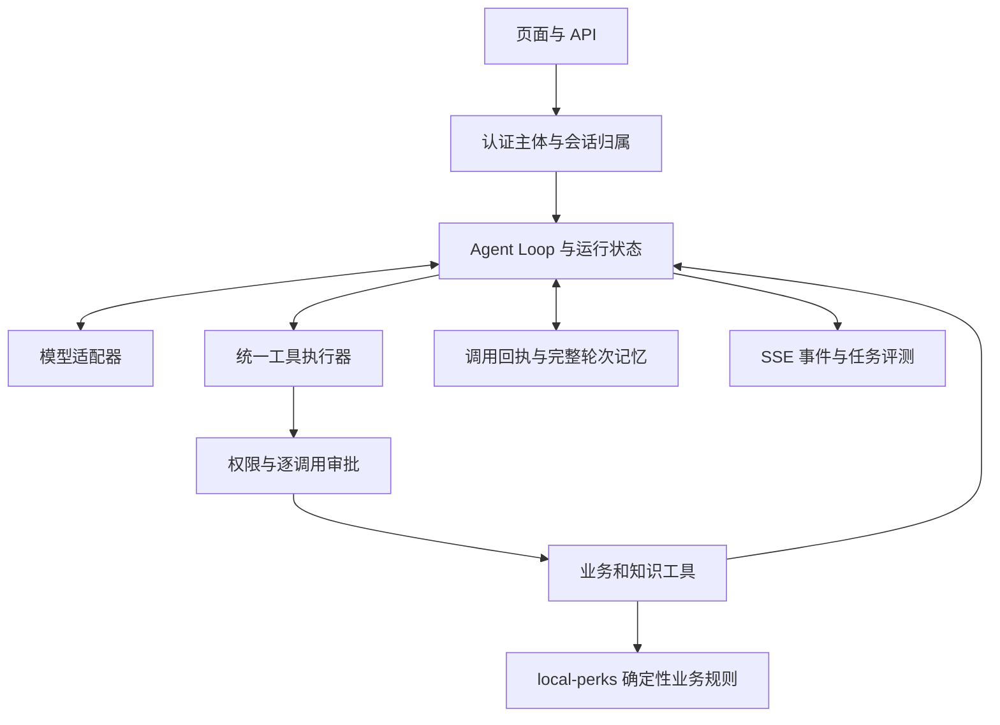

截至 2026-10-18，本项目已经形成“本地生活业务 + 能调用真实业务工具的 Agent”的功能闭环，当前应进入正确性、故障恢复和可复现验收阶段。优先处理用户隔离、审批失败后的副作用、并发库存对账，随后补运行回执和针对新 Agent Loop 的评测。

这份核查以源码和实际测试为依据。此前“基础闭环尚未验证”的结论已被后续开发记录更新；“M1–M4 已完成”也不能直接等同于当前版本已通过安全、重启恢复和性能验收。

**核查范围与证据。** local-perks 基准提交是 765a473（2026-10-18 02:22，资料清空修复及测试图片清理）；EchoMindJava 是实际运行工程，不是下载 ZIP 中的原始模板。本次在工作区内复制 pom、80 个生产 Java 文件和 7 个测试文件，生成 SHA-256 清单，未复制密钥、应用配置和业务数据。测试后复核这 88 个原始文件，未发现与源工程不同。

参考依据包括[项目记忆](D:/PyChram_project/Java_learn/Redis/local-perks/.workbuddy/memory/MEMORY.md)、[当日开发记录](D:/PyChram_project/Java_learn/Redis/local-perks/.workbuddy/memory/2026-10-18.md)、[上一版路线](D:/PyChram_project/Java_learn/Redis/local-perks/docs/agent-next-steps-2026-10-17.md)、本地 Claude Code 源码快照及教学实现。原始 EchoMind ZIP 仍作为功能来源参照；本次判断以已经改造的 EchoMindJava 为准。

| 领域 | 当前实际进展 | 验证程度 |
| --- | --- | --- |
| 交易 | Redis Lua、RocketMQ 事务消息及回查、异步落单、本人订单查询、模拟支付、取消、核销、退款、延迟关单和定时对账 | 有历史真实链路记录；本次静态审查发现对账并发风险 |
| 业务扩展 | Redis 限流、Caffeine/Redis 缓存、布隆过滤器、缓存失效通知、评论、管理员接口 | 本地保存的后端报告共 18 项通过，包含依赖 MySQL/Redis/MQ 的集成测试 |
| Agent 主循环 | Spring AI 手动执行循环、21 个注册工具、6 个需确认的业务写工具、逐调用审批、Lua 原子认领、订单排队状态表达 | 本次隔离复跑原有 41 项测试全部通过 |
| 交互与上下文 | SSE 正文与工具事件、按需加载 Skills、工具结果截断、上下文压缩、长期记忆、会话互斥 | 相关测试存在；身份隔离、提交幂等和恢复仍有缺口 |
| 子 Agent | 购物、内容、交易三个受限角色；角色工具白名单；业务写操作保留在主 Agent | 白名单测试通过；未证明优于单 Agent，尚缺成本和正确率对比 |
| 前端 | 助手页、审批卡片、步骤折叠、记忆抽屉、个人资料、我的评价、粉丝/关注、订单时钟校准 | 有历史接口冒烟和页面验证；部分截图使用模拟 XHR/SSE，不能视作真实全链路验证 |
| 评测与交付 | 已有旧评测器、若干构建和验收记录 | 评测仍走旧 orchestrator；README、启动方法和新增迁移说明需要同步 |

**本次实际测试结果。** 在不修改生产源码、不连接模型或业务数据库的隔离副本中完成以下检查：

| 检查 | 结果 | 能证明什么 |
| --- | --- | --- |
| 原有 7 个测试类 | 41 项通过，0 失败、0 错误 | 既有单元场景仍然通过 |
| 新增 AuditControllerBoundaryTest | 6 项断言失败，0 执行错误 | 稳定复现两类边界缺陷，而不是新增了 6 个不同根因 |
| 原工程后端报告 | 18 项通过，报告最近时间约 02:18 | 历史验证证据；本次未重新运行会写数据库的集成测试 |
| 全栈在线状态 | 本轮未确认 | 审计沙箱阻止了本机套接字连接；不能把连接失败判断成服务已停止 |

新测试的具体观察：无 token 时可以解析成指定的注册用户 ID；未认证的记忆 GET、POST、DELETE 均返回 200；模拟审批归属拒绝和重复确认拒绝后，控制器仍各调用了一次记忆提交服务。MockMvc 使用单控制器，业务依赖全部为 mock；同时源码中未发现为这些入口注册的认证过滤器或拦截器，Nginx 的 /cs-api 代理也没有补充认证。这是控制器边界回归，不是线上攻击测试。

测试运行使用本机 JDK 25.0.4、编译目标 release 21、Maven 3.9.9。Mockito 改为启动时加载 agent，JUnit 临时目录放到工作区后，原有 41 项全部通过；没有修改被测实现。这不能替代在目标 JDK 21 下的交付验证。

证据保存在[基线测试日志](D:/PyChram_project/Java_learn/Redis/local-perks/.workbuddy/tmp/audit-2026-10-18/baseline-test.log)、[边界回归日志](D:/PyChram_project/Java_learn/Redis/local-perks/.workbuddy/tmp/audit-2026-10-18/boundary-regression-test.log)、[回归用例源码](D:/PyChram_project/Java_learn/Redis/local-perks/.workbuddy/tmp/audit-2026-10-18/echomind/src/test/java/com/echomind/api/AuditControllerBoundaryTest.java)、[源码哈希清单](D:/PyChram_project/Java_learn/Redis/local-perks/.workbuddy/tmp/audit-2026-10-18/source-manifest.json)。这些临时材料位于被 Git 忽略的目录，修复时应把回归用例迁入 EchoMind 的正式测试目录。

**需要先修的三个问题。** 以下 P1 表示进入多人使用或对外演示前应修复；P2 表示下一阶段应完成的可靠性和验收工作。

1. **P1：服务端仍允许客户端选择记忆所属用户，已复现。** [EchoMindController.java:301](D:/PyChram_project/Java_learn/Redis/EchoMind参考代码/EchoMindJava/src/main/java/com/echomind/api/EchoMindController.java:301) 在没有 token 时直接采用 fallbackUserId；传入注册用户格式的 ID 仍会被接受。有效 token 的分支已经修好，但未覆盖无 token 分支。GET/POST/DELETE /memory 在[第 482 行附近](D:/PyChram_project/Java_learn/Redis/EchoMind参考代码/EchoMindJava/src/main/java/com/echomind/api/EchoMindController.java:482)只检查 ID 非空、不是 anonymous，没有校验登录主体。因此可按指定 ID 读取、覆盖或删除长期记忆。旧 /chat、运行轨迹查询、知识库写入和评测入口也应统一检查权限，不能只修页面当前调用的入口。

   处理方向：注册用户 ID 只来自 local-perks 验证过的登录态；游客使用服务端签发、与注册用户命名空间分离的会话。业务资源按认证主体做归属校验，记忆 API 不再信任请求中的 user_id。记忆工具从可信执行上下文取身份。前端记忆请求同步携带认证信息。

2. **P1：被拒绝的审批仍会写入原用户记忆，已复现。** [EchoMindController.java:268](D:/PyChram_project/Java_learn/Redis/EchoMind参考代码/EchoMindJava/src/main/java/com/echomind/api/EchoMindController.java:268) 的条件只排除了等待审批和 CANCELLED，没有排除 ERROR。AgentLoopRunner 对他人确认、重复确认等返回 ERROR，但控制器随后 load 原审批，按原用户和会话调用 memoryCommit。审批执行权没有被绕过，拒绝后的记忆副作用却发生了。重复点击会重复记入原请求及错误文本；拿到有效审批标识的其他调用者也可能污染原用户历史。

   处理方向：区分“本次实际恢复完成”“拒绝认领”“回放已有结果”；拒绝路径没有记忆或业务副作用。以 userId + conversationId + runId 做最终提交幂等。已完成的同用户重试返回已有回执。JSON、SSE、approve 共用会话协调机制，避免审批恢复与新一轮聊天交叉提交。

3. **P1：库存对账可能覆盖正常交易扣减，静态并发分析。** [TradeReconcileTask.java:112](D:/PyChram_project/Java_learn/Redis/local-perks/src/main/java/com/hmdp/task/TradeReconcileTask.java:112)分开读取 Redis 库存、占用数和数据库取消数，再于第 124 行无条件 SET；MySQL 分支也按旧快照计算后直接 UPDATE。AtomicBoolean 只能防本实例任务重入，既不协调多个实例，也不协调正在下单的线程。

   一个从正常库存开始的交错即可出问题：对账读到 stock=7；订单 A 扣到 6；对账读到对应占用数，计算 expected=6；订单 B 再扣到 5；对账比较旧值 7 与 expected=6 后 SET 6，覆盖了一次有效扣减。该交错本轮没有通过真实 Redis/MQ 压测复现，不能说已经观察到超卖，但代码路径允许发生。

   [AdminServiceImpl.java:69](D:/PyChram_project/Java_learn/Redis/local-perks/src/main/java/com/hmdp/service/impl/AdminServiceImpl.java:69)的 force 预热也会用数据库库存覆盖 Redis；异步订单尚未落库时两者不同本来就是正常现象。近期应让进行中的活动只做差异观测，修复操作进入明确的暂停/排空流程。后续用带版本或水位的状态记录设计在线修复。只给定时任务再加一把分布式锁仍不足以解决与下单的竞争。

**另外五项需要补强。**

| 优先级 | 事实与影响 | 下一步 |
| --- | --- | --- |
| P2 审批结果持久化 | [AgentLoopRunner.java:174](D:/PyChram_project/Java_learn/Redis/EchoMind参考代码/EchoMindJava/src/main/java/com/echomind/toolcall/loop/AgentLoopRunner.java:174)在执行工具前就 complete 成 CONSUMED。Redis 保留的是挂起快照，尚无实际执行结果回执；[AgentRunStore](D:/PyChram_project/Java_learn/Redis/EchoMind参考代码/EchoMindJava/src/main/java/com/echomind/toolcall/loop/AgentRunStore.java:22)仅在内存保存最近 256 项。当前提供最多一次认领/尝试，不能据此宣称重启恢复完成 | 分离认领与完成，持久化每次调用的执行位置、结果和未知状态；重复确认查询结果，不重新发起写操作 |
| P2 执行预算 | toolTimeoutMs 只见声明与赋值；[doExecute 第 594 行](D:/PyChram_project/Java_learn/Redis/EchoMind参考代码/EchoMindJava/src/main/java/com/echomind/toolcall/loop/AgentLoopRunner.java:594)同步调用 callback。恢复路径为每个工具重新生成 deadline，随后再次给主循环剩余预算；子 Agent 使用独立 timeout/NOOP 监听器 | 计算统一剩余执行预算，贯穿模型、工具、子 Agent 和恢复；取消后禁止发起新的副作用。写调用超时只能先记结果未知，不能承诺已经回滚 |
| P2 缓存链路 | [ShopServiceImpl.java:66](D:/PyChram_project/Java_learn/Redis/local-perks/src/main/java/com/hmdp/service/impl/ShopServiceImpl.java:66)先查 Redis 上的 Bloom，再查 Caffeine，L1 命中仍要一次远程查询。[ShopBloomFilter.java:77](D:/PyChram_project/Java_learn/Redis/local-perks/src/main/java/com/hmdp/cache/ShopBloomFilter.java:77)插入失败只记录日志，未降级为不可靠状态；新店可能在 Redis 恢复后长期被误挡 | 先查 L1，再按需要查 Bloom/L2；Bloom 覆盖不完整时放行并补建，重建完成再切换。测试“删 Redis 缓存键”不能证明“完全不访问 Redis” |
| P2 历史提交与压缩 | 新 ContextManager 已实现上下文预算；旧 [MemoryManager.java:116](D:/PyChram_project/Java_learn/Redis/EchoMind参考代码/EchoMindJava/src/main/java/com/echomind/memory/MemoryManager.java:116)的历史压缩仍先读、摘要、删除列表、重写。当前会话锁是进程内的，approve 又没有走同一把锁 | 对话完整轮次原子追加，压缩按版本/快照条件提交；不满足条件则保留新消息并重试。明确单实例边界后再宣称支持多实例 |
| P2 评测目标错误 | [EndToEndEvaluator.java:74](D:/PyChram_project/Java_learn/Redis/EchoMind参考代码/EchoMindJava/src/main/java/com/echomind/evaluation/EndToEndEvaluator.java:74)仍调用旧 AgentOrchestrator。其意图识别和回答评分无法验收新工具循环、HITL、SSE 或订单真实状态 | 新建针对当前 ToolCallingAgent/HTTP 入口的任务评测，使用业务状态与工具轨迹断言，回答质量评分作补充 |

**当前设计中合理、应继续沿用的部分。** Java 8 业务工程与 Java 21+ AI 工程通过 HTTP 分离，符合现有依赖约束；Spring AI 负责模型适配、schema 和 callback，自己的循环负责权限、预算及状态。逐调用授权、Redis Lua 抢占、异步下单返回 PENDING、子 Agent 只读白名单、Skills 按需加载、工具结果压缩，都已经落地，应在其上补边界。

现有主交易模式已经使用 RocketMQ 事务消息、回查标记和消费幂等，不需要因为可靠性问题立即换一整套消息架构。应先验证这些机制在具体故障窗口的行为。支付模拟、退款直接到完成、退款不回补库存、取消后仍限制一人一券一次，是可以保留的演示业务规则，但必须讲清楚。当前核销由订单本人触发，也应标为模拟核销；若走真实商家场景，核销主体和门店权限需要另外建模。

不合理之处主要在验收口径：新增了很多能力，但“有类、有页面、有通过的单测”还不能证明用户隔离、故障恢复或性能提升。现有子 Agent 应先验证收益，再决定是否增加角色。ES、Canal、分库分表和更复杂的 Agent 编排，暂时缺少本项目数据规模和评测结果的支撑。

**对齐 Claude Code 的下一层工作，应落在执行契约。** 本地教学代码用于理解机制，本地 claude-code-main/src 快照用于检查边界，不把某份快照当作官方最新实现。官方说明中的核心是模型根据工具结果继续循环，Skills、子 Agent 等围绕循环扩展。[Claude Code 工作方式](https://code.claude.com/docs/en/how-claude-code-works)

| 本地源码参照 | 当前 Java 落点 | 应补的行为 |
| --- | --- | --- |
| [query.ts](D:/PyChram_project/learn-claude-code-main/claude-code-main/src/query.ts) | AgentLoopRunner | 共用运行状态、累计执行预算、取消信号、终止原因 |
| [Tool.ts:402](D:/PyChram_project/learn-claude-code-main/claude-code-main/src/Tool.ts:402) | ToolRegistry 与工具描述 | 显式表达 isReadOnly、isConcurrencySafe、输入校验和权限检查，不能把“不需审批”当成“只读” |
| [toolExecution.ts](D:/PyChram_project/learn-claude-code-main/claude-code-main/src/services/tools/toolExecution.ts) | 从主循环抽取 ToolExecutor | 普通执行、审批恢复、子 Agent 都走同一套校验、权限、预算和结果处理 |
| [toolOrchestration.ts](D:/PyChram_project/learn-claude-code-main/claude-code-main/src/services/tools/toolOrchestration.ts) | 工具调度 | 先保持顺序执行；只有已证明独立且安全的读调用才允许并行 |
| SkillTool 与 compact 相关实现 | SkillManager、ContextManager | 保留按需加载和结果预算，补压缩前后的事实保持及调用/结果配对验收 |
| 工具生命周期事件 | SSE、Trace、RunStore | 同一套事件服务于页面、恢复、诊断和评测；重连只查已有运行 |

继续使用 Spring AI 1.1 已支持的手动工具循环。身份通过 ToolContext 或等效的可信执行上下文传递，不成为模型可自行填写的业务参数；Spring AI 文档说明 ToolContext 数据不发送给模型。[Spring AI 1.1 工具调用](https://docs.spring.io/spring-ai/reference/1.1/api/tools.html)

**后续实施按五个可验收阶段推进。** 下列时间是有效开发日的粗排，约 7–11 日；学习讲解、环境修复和新增需求另计。每一阶段以验收通过为结束条件。

| 阶段 | 预计投入 | 交付物 | 必须通过的验收 |
| --- | --- | --- | --- |
| A：身份与审批提交 | 1–2 日 | 统一身份入口、资源归属校验、审批结果分类、记忆提交幂等、前端认证适配 | 本次 6 项回归全部转绿；跨用户访问拒绝；拒绝/重复审批不写业务和记忆 |
| B：交易一致性 | 1–2 日 | 对账观测/修复分离、受控预热、并发和故障测试 | 对账与下单交错不制造库存；重复消息、支付/关单竞争、暂停修复都满足业务不变量 |
| C：Agent 可靠执行 | 2–3 日 | ToolExecutor、运行/调用回执、统一预算、取消传播、原子历史提交 | 重启能查到真实状态；未知结果不自动重放；子 Agent 服从父任务预算；记忆不丢、不重复 |
| D：缓存与新链路评测 | 2–3 日 | Bloom 故障恢复、缓存指标、任务集、单/多 Agent 对比、真实 E2E 与压测报告 | 性能和质量有可复现实测；全部关键规则按业务状态验收 |
| E：交付整理 | 1 日 | 双工程版本清单、启动/停止/健康检查、数据库迁移、README、演示与答辩材料 | 从干净环境按文档能重现演示；说明与实际实现一致 |

阶段 A 可以拆成两次小提交。第一次把本次回归用例迁入正式工程，修 resolveUserId、memory API 和前端记忆认证请求，同时覆盖旧 /chat 和 trace 的归属。第二次修 approve 的结果分类与提交幂等，并统一 JSON/SSE/approve 的会话协调。知识库修改、Skills 重载、评测执行等管理操作应明确使用已有管理员身份或仅在受控开发环境启用。

A 的验收矩阵至少包括：无 token；过期 token；用户 A 指定用户 B 的 ID；A 访问 B 的会话/运行；确认错误用户的审批；同用户重复确认；真实 Redis 上并发确认。最后一种测试验证 Lua 与部署行为，不能只用内存 HashMap mock 替代。审批和会话 ID 应绑定已认证主体，UUID 的难猜程度不替代归属校验。

阶段 B 先为交易建立独立测试数据库、Redis key 前缀和 MQ topic/consumer group，防止回归修改演示数据。沿用当前事务消息设计，分别注入消息提交前后、消费前后和关闭订单前后的中断。至少覆盖：

- 两笔下单与库存对账交错；两次手工对账与定时对账重叠。
- 重复消费同一消息，不多扣数据库库存、不多建订单。
- 支付与关单同时发生，只允许一个合法状态转换及对应库存动作。
- 活动进行中禁止强制覆盖库存；暂停、等待处理中消息收敛后才进行受控修复。
- 事务消息回查能够区分提交、回滚和未知；未知结果有观察和处理路径。
- 超过单批数量的超时订单最终被处理，批处理上限不会留下永久占用。

将“库存在各存储上完全相等”替换为“按明确时间点、待处理预占与订单状态解释差异”。异步交易有正常的短暂差异；不能看到数字不同就覆盖。

阶段 C 先抽取共享执行路径，不按目录大搬家。工具描述补充只读/并发属性，结果保留调用状态、业务状态、是否可重试、错误码和来源。减少依赖中文前缀推断状态，业务失败不能在页面和指标上被当作业务成功。

运行建议保留 RUNNING、WAITING_APPROVAL、COMPLETED、FAILED、CANCELLED；调用回执保留 PENDING、EXECUTING、SUCCEEDED、FAILED、OUTCOME_UNKNOWN。审批等待时间不计执行预算，但恢复后的模型、工具和子 Agent 消耗必须继续累计。认领成功后、发 HTTP 前崩溃，以及 HTTP 成功后、记录结果前崩溃，是两种不同的故障窗口，分别测试。

跨 HTTP 写调用出现超时或进程中断时，先依据订单 ID/业务操作键查询真实结果。数据库唯一约束、条件状态更新、业务操作幂等仍由 local-perks 承担；Agent 的审批标记不能提供跨系统“恰好一次”。用户断开 SSE 也不等于远端业务撤销，页面应展示已确认的状态或结果待确认。

会话历史以完整轮次提交，提交键关联 runId；压缩只替换仍与输入快照一致的历史。长期文件记忆在当前单实例演示中可以继续使用，但应明确部署限制。后续多实例再补共享存储和版本协调，避免过早引入新数据库。

阶段 D 的缓存验收至少包括：L1 命中时远程调用次数；L1 未命中时回源次数；两实例更新后的失效传播；Redis 短暂不可用时新增店铺；Bloom 重建期间新店可见；失效消息丢失后的 TTL 收敛。先修 Bloom 完整性和调用顺序，再比较延迟。

新评测集建议先固定 30 个任务：8 个店铺/券查询，8 个审批与交易流程，6 个身份或故障场景，4 个知识/记忆场景，4 个长上下文或多工具任务。每个任务保存初始数据、预期工具/业务状态、禁止动作和允许的最终回答；写操作在隔离测试环境内运行。安全边界全部用确定性断言，不交给 LLM judge 评分。

对同一任务集比较单 Agent 与受限子 Agent 配置，记录完成率、错误工具选择、未授权副作用、工具调用数、模型调用数、首 token 时间、总耗时和 token 用量。估算 token 与模型返回的真实 usage 分开统计。含随机性的模型场景至少重复三次；30 个任务只是首版回归集，不是普遍正确率的统计证明。

后端性能测试与 Agent 端到端延迟分开报告。当前 SeckillConcurrencyTests 使用 100 个任务、20 个工作线程、库存 10，并直接调用 service；它有并发功能测试价值，不能据此写出完整 HTTP 链路 QPS。新压测应固定机器、提交、数据规模、预热与测量时长，列出吞吐、p50/p95/p99、错误率、Redis 操作量和数据库回源量。缓存开/关、冷热状态对照，避免用一次响应时间代表优化效果。

真实 E2E 至少完成：查店查券、确认下单、轮询最终状态、模拟支付、模拟核销、另一订单的取消/退款，以及拒绝审批、重复确认、越权、SSE 断开与重连。最终页面读取真实服务响应；模拟 XHR/SSE 截图继续用于布局验证，单独记录。

阶段 E 将当前分散在 .workbuddy/tmp 的有效脚本整理为可版本管理的启动、停止、检查和测试入口，启动命令明确两套 JDK 与 Maven 路径/参数，凭据使用环境变量。README 增补 V3 评论迁移、管理员配置、EchoMind 工程位置及版本、端口、演示数据准备方法；修正“当前没有角色权限”等过时说明。已有 V2/V3 SQL 不能仅靠文件名假设自动执行，先记录项目实际采用的迁移方式。

交付材料围绕三条可讲清楚的技术主线组织：Redis/MQ 交易一致性，Caffeine/Redis 缓存及失效，参照 Claude Code 执行契约的业务 Agent。简历性能数字只能来自保存的压测报告，模拟支付和核销如实说明。

**与前置学习内容的对应关系。** 现有学习资料已经覆盖 Spring MVC、AOP、ThreadLocal、Redis 数据结构、HTTP、Spring Cache 和定时任务；接下来把这些知识推进到明确的状态与故障边界。

| 已有基础 | 在本项目应补的理解 | 对应成果 |
| --- | --- | --- |
| Spring MVC、拦截器、ThreadLocal | 认证主体与资源归属；异步线程的上下文传递与清理 | 阶段 A 的跨用户回归和统一执行上下文 |
| Redis、Lua、Set/ZSet、锁 | 单次原子操作与跨步骤一致性的区别；锁的实际保护范围 | 原子审批认领、对账交错测试、会话协调 |
| MySQL、事务、唯一索引 | 条件更新、回滚、消费幂等和外部系统副作用 | 重复消息、支付/关单竞争的确定性验证 |
| Spring Cache、HTTP | 缓存命中并不等于零网络；超时不等于对方没有执行 | 缓存调用量对照、OUTCOME_UNKNOWN 与结果查询 |
| AOP、Spring Task | 功能开关、限流语义、单实例与多实例调度边界 | 限流/调度验收、可解释的指标与运行手册 |

下一次实施从阶段 A 的第一小步开始：将本次 6 项失败用例移入正式 EchoMind 测试，修身份来源和记忆入口，随后修审批错误路径的提交副作用。完成这一步即可得到一个边界清楚、改动有限、可验证的成果。

本次只新增本报告和被忽略目录中的隔离测试材料；未修改生产源码、未启动服务、未执行业务写接口或推送远端。
