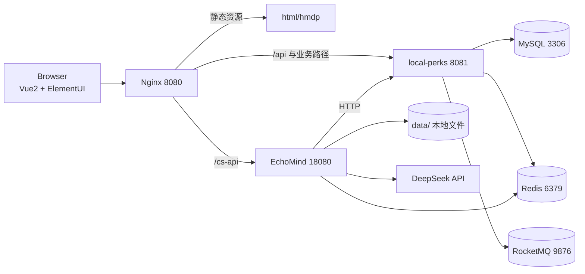
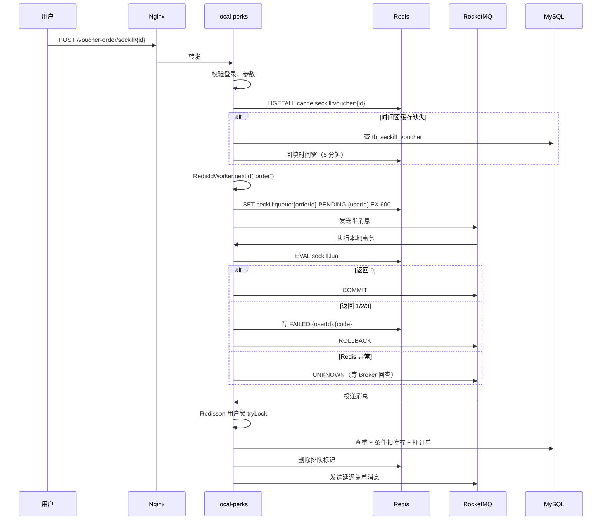

# LocalPerks 项目全景手册（2026-10-19）

> 这份文档的目标不是“介绍项目”，而是让你在压测之前，能准确说出：**请求从哪进来、经过哪些组件、状态写到哪里、失败时会发生什么、哪些结论有证据、哪些只是实现但未验证。**
>
> 阅读顺序建议见第 17 节。压测前的检查清单见第 18 节。

---

## 0. 先建立三个全局认知

### 0.1 这不是一个工程，是两个进程

| 进程 | 默认端口 | 技术栈 | 职责 |
| --- | --- | --- | --- |
| `local-perks` | 8081 | Java 8、Spring Boot 2.3.12、MyBatis-Plus、Redis、Redisson、RocketMQ、Caffeine | 业务主链路：用户、店铺、优惠券、秒杀、订单、内容、社交、评论、管理端 |
| `EchoMind` | 18080 | Java 21、Spring Boot 3.5、Spring AI 1.1、DeepSeek | 智能客服：Agent Loop、工具调用、审批、记忆、技能、知识库、子 Agent |
| `Nginx` | 8080 | Nginx 1.18 | 静态页面 + `/api` 与业务路径反代 8081 + `/cs-api` 反代 18080 |

EchoMind 不是 local-perks 的模块，而是通过 HTTP 调用 local-perks 的业务接口。它自己还有 Redis（审批状态、短期记忆）和本地文件（长期记忆、知识库）。

### 0.2 三条技术主线

| 主线 | 核心问题 | 主要代码 |
| --- | --- | --- |
| 交易一致性 | Redis 扣了库存，数据库订单没落库怎么办；重复消息怎么办；取消/退款/关单竞争怎么办 | `seckill.lua`、`SeckillTransactionListener`、`SeckillOrderConsumer`、`VoucherOrderServiceImpl`、`TradeReconcileTask` |
| 缓存与治理 | L1/L2 怎么配合；缓存失效怎么传播；布隆过滤器坏了怎么办；限流怎么做到多维度 | `ShopServiceImpl`、`ShopLocalCache`、`ShopBloomFilter`、`ShopCacheInvalidationPublisher`、`RateLimitAspect` |
| 业务 Agent | 模型怎么选工具；写操作怎么审批；上下文怎么压缩；记忆怎么隔离；子 Agent 怎么只读 | `AgentLoopRunner`、`ToolRegistry`、`ToolApprovalService`、`ContextManager`、`AssistantMemoryService`、`SubAgentRole` |

### 0.3 先分清“实现了”和“验证过”

- **实现了**：代码存在，能编译，接口能跑。
- **验证过**：有测试、有日志、有压测报告或真实链路记录。
- **边界**：代码里明确写了“单实例”“模拟”“未接入”“默认关闭”。

这份文档会在关键处标注这三类状态。压测能补的是“性能验证”，补不了“功能没做”。

---

## 1. 全局架构

### 1.1 请求路径

```text
浏览器
  ├─ 静态页面  http://localhost:8080/*.html
  ├─ 业务接口  http://localhost:8080/api/*        → Nginx rewrite → 127.0.0.1:8081
  ├─ 业务接口  http://localhost:8080/shop/* 等    → Nginx 直接反代 → 127.0.0.1:8081
  └─ 助手接口  http://localhost:8080/cs-api/*     → Nginx 反代 → 127.0.0.1:18080
```

后端出站：

```text
local-perks 8081
  ├─ MySQL 3306     业务数据
  ├─ Redis 6379     登录态、缓存、库存、点赞、Feed、限流、布隆、Pub/Sub
  └─ RocketMQ 9876  事务消息、延迟关单消息

EchoMind 18080
  ├─ Redis 6379     审批状态、短期记忆
  ├─ 本地文件       data/memory、data/compacted、knowledge-store.json、skills/
  ├─ DeepSeek API   模型调用
  └─ HTTP → 8081    21 个业务工具的底层接口
```

### 1.2 组件图



### 1.3 关键设计取舍

| 取舍 | 选择 | 代价 |
| --- | --- | --- |
| 业务服务与 Agent 分离 | Java 8 业务 + Java 21 Agent，HTTP 通信 | 多一个进程、多一次网络往返；但避免了 Java 8 无法用 Spring AI 的冲突 |
| 秒杀入口扣库存 | 模式 A 在入口 Lua 预扣 | 入口要承担 Redis + MQ 事务开销；换来入口就能挡住无效流量 |
| 订单异步落库 | RocketMQ 消费端落库 | 前端要轮询状态；存在短暂的 Redis/DB 不一致窗口 |
| 缓存一致性 | 先写库，提交后删缓存 + Pub/Sub + TTL | 不是强一致；广播丢失时靠 TTL 收敛 |
| 一人一单 | Redis Set + 唯一索引 + 终身保留 | 取消/退款后仍不能再买同一张券；业务上要能解释 |
| Agent 写操作 | 主 Agent 逐调用审批 | 多一次交互；换来不可逆操作可控 |

---

## 2. 目录地图

### 2.1 local-perks

```text
local-perks/
├─ pom.xml
├─ README.md
├─ deploy/rocketmq/                 NameServer/Broker 启动脚本与 broker.conf
├─ docs/                            设计、复核、简历与压测文档
├─ nginx-1.18.0/
│  ├─ conf/nginx.conf               静态资源、/api、业务路径、/cs-api
│  └─ html/hmdp/                    12 个页面 + js/css/imgs
├─ src/main/java/com/hmdp/
│  ├─ HmDianPingApplication.java    启动类
│  ├─ annotation/                   @RateLimit、@AdminOnly
│  ├─ aspect/                       限流切面、管理员切面
│  ├─ cache/                        Caffeine L1、布隆、失效广播
│  ├─ config/                       拦截器、Redisson、Redis Pub/Sub、异常处理、属性类
│  ├─ controller/                   11 个 REST 控制器
│  ├─ dto/                          Result、登录/资料/秒杀消息/滚动分页
│  ├─ entity/                       10 张表的实体
│  ├─ exception/                    Forbidden、RateLimit
│  ├─ mapper/                       MyBatis-Plus Mapper + 评论联表 SQL
│  ├─ mq/                           生产者、事务监听器、下单消费者、关单消费者
│  ├─ service/                      接口与实现
│  ├─ task/                         库存对账 + 超时补关单
│  ├─ utils/                        登录拦截、Token 刷新、Redis ID、缓存客户端、状态常量
│  └─ vo/                           订单、评论、状态视图
├─ src/main/resources/
│  ├─ application.yaml              主配置
│  ├─ application-local.yaml        本地配置（已 gitignore）
│  ├─ db/hmdp.sql                   全量建表 + 演示数据
│  ├─ db/V2__trade.sql              交易增量：唯一索引、关单索引、total_stock
│  ├─ db/V3__comment.sql            评论增量：索引、NULL 归一化
│  └─ *.lua                         8 个 Lua 脚本
└─ src/test/java/com/hmdp/          14 个测试类、45 个 @Test
```

### 2.2 EchoMind

```text
EchoMindJava/
├─ src/main/java/com/echomind/
│  ├─ api/                          控制器、SSE 服务、DTO
│  ├─ toolcall/
│  │  ├─ business/                  LocalPerksTools、KnowledgeTools、MemoryTools、SkillTools、DelegateTool
│  │  ├─ loop/                      AgentLoopRunner、ToolRegistry、ToolApprovalService、SubAgentService
│  │  ├─ annotation/                @RequiresApproval
│  │  └─ ToolCallingAgent.java      新链路的门面
│  ├─ context/                      ContextManager：预算、microcompact、autocompact、工具结果落盘
│  ├─ memory/                       短期记忆、长期文件记忆、提交幂等
│  ├─ skill/                        SkillManager：索引常驻、正文按需
│  ├─ knowledge/                    BM25 + n-gram 哈希向量检索
│  ├─ agent/                        旧的多 Agent 路由（General/Technical/Billing）
│  ├─ intent/                       旧意图识别
│  ├─ evaluation/                   旧评测器（仍走旧 orchestrator）
│  ├─ trace/                        工具调用轨迹
│  ├─ monitor/                      成功率/延迟监控
│  ├─ llm/                          LlmGateway 与 Spring AI 适配
│  └─ config/                       属性、异步、定时、OpenAPI
├─ src/main/resources/application.yml
├─ skills/                          3 个技能包：billing/general/technical
└─ data/                            知识库、记忆、压缩落盘
```

### 2.3 包职责速查

| 包 | 一句话 | 读的时候先看谁 |
| --- | --- | --- |
| `controller` | 参数校验 + 调 service，不写业务 | `VoucherOrderController` |
| `service.impl` | 业务规则、事务、状态流转 | `VoucherOrderServiceImpl`、`ShopServiceImpl` |
| `mq` | 消息生产、事务回查、消费幂等 | `SeckillTransactionListener`、`SeckillOrderConsumer` |
| `cache` | L1、布隆、失效广播 | `ShopLocalCache`、`ShopBloomFilter` |
| `aspect` | 横切：限流、管理员 | `RateLimitAspect` |
| `config` | 拦截器顺序、线程池、Pub/Sub、异常映射 | `MvcConfig`、`RedisPubSubConfig` |
| `task` | 定时对账、补关单 | `TradeReconcileTask` |
| `utils` | 登录态、ID、缓存客户端、常量 | `RedisConstants`、`CacheClient` |

---

## 3. 数据模型

### 3.1 表清单

| 表 | 作用 | 关键字段 | 索引/约束 |
| --- | --- | --- | --- |
| `tb_user` | 用户 | `id`、`phone`、`nick_name`、`icon` | `uniqe_key_phone(phone)` 唯一 |
| `tb_user_info` | 用户资料 | `user_id`、`city`、`introduce`、`fans`、`followee`、`gender`、`birthday`、`credits`、`level` | 主键 `user_id`，非自增 |
| `tb_shop` | 店铺 | `id`、`name`、`type_id`、`x`、`y`、`score`、`sold`、`comments` | `foreign_key_type(type_id)` |
| `tb_shop_type` | 店铺分类 | `id`、`name`、`icon`、`sort` | 主键 |
| `tb_voucher` | 优惠券主表 | `id`、`shop_id`、`title`、`pay_value`、`actual_value`、`type`、`status` | 主键 |
| `tb_seckill_voucher` | 秒杀券库存与时窗 | `voucher_id`、`stock`、`total_stock`、`begin_time`、`end_time` | 主键 `voucher_id`；`total_stock` 是 V2 新增 |
| `tb_voucher_order` | 订单 | `id`、`user_id`、`voucher_id`、`pay_type`、`status`、`create_time`、`pay_time`、`use_time`、`refund_time` | `uk_user_voucher(user_id, voucher_id)` 唯一；`idx_status_create(status, create_time)` |
| `tb_blog` | 探店笔记 | `id`、`shop_id`、`user_id`、`title`、`images`、`content`、`liked`、`comments` | 主键 |
| `tb_blog_comments` | 评论 | `id`、`user_id`、`blog_id`、`parent_id`、`answer_id`、`content`、`liked`、`status` | V3：`idx_blog_parent(blog_id,parent_id,id)`、`idx_parent(parent_id,id)`、`idx_user(user_id,id)` |
| `tb_follow` | 关注 | `id`、`user_id`、`follow_user_id` | 主键；代码未建唯一索引，后端也没有重复关注去重，可能产生重复行 |

### 3.2 字段约定

| 约定 | 说明 |
| --- | --- |
| 金额单位 | 分。`pay_value=4750` 表示 47.50 元；前端 `util.formatPrice` 统一转元 |
| 评分 | 乘 10 保存，37 表示 3.7 分；前端 `formatScore` 转换 |
| 订单 ID | `RedisIdWorker`：`(当前秒 - 2022-01-01) << 32 | 当日自增`；约 5×10^17，超出 JS 安全整数，接口返回字符串 |
| 用户资料主键 | `tb_user_info.user_id` 非自增，实体必须 `IdType.INPUT` |
| 逻辑删除 | 评论用 `status=2` 表示隐藏，不做物理删除；删除主评论会连带隐藏回复 |
| 库存 | `tb_seckill_voucher.stock` 是剩余库存；`total_stock` 是对账基准；`tb_voucher` 没有库存列 |

### 3.3 订单状态机

```text
UNPAID(1) ──支付──> PAID(2) ──核销──> USED(3)
    │                   │
    │                   └──退款──> REFUNDED(6)
    └──取消/超时关单──> CANCELED(4)

REFUNDING(5) 常量存在，但当前退款直接落到 REFUNDED，没有“退款中”中间态
```

所有流转都用条件更新（CAS），不做“先查后改”：

```sql
UPDATE tb_voucher_order
SET status = 2, pay_type = ?, pay_time = NOW()
WHERE id = ? AND user_id = ? AND status = 1;
```

影响行数为 0 就返回“订单状态已变更”，由调用方重试或刷新。

---

## 4. Redis key 全景

| Key | 类型 | TTL | 写入方 | 读取方 | 作用 / 失败行为 |
| --- | --- | --- | --- | --- | --- |
| `login:code:{phone}` | String | 2 分钟 | 发送验证码 | 登录 | 一次性验证码；Lua 比对并删除，防重放 |
| `login:token:{token}` | Hash | 36000 分钟（约 25 天） | 登录 | 刷新拦截器 | 登录态；每次请求刷新 TTL。**注意单位是分钟，不是秒** |
| `cache:shop:{id}` | String | 30 分钟 | 缓存回源 | 店铺查询 | 店铺 JSON；删除后回源 |
| `cache:shop:{id}`（空值） | String `""` | 2 分钟 | 回源为空 | 店铺查询 | 空值缓存，防穿透 |
| `lock:shop:{id}` | String | 10 秒 | `CacheClient` | `CacheClient` | 缓存重建互斥锁；只删自己 token |
| `bloom:shop` | Redis Bloom | 无 | 启动加载/新增店铺 | 店铺查询 | 10,000 预期插入、1% 误判；异常时 fail-open |
| `cache:invalidate:shop` | Pub/Sub | 无 | 店铺更新 | 所有实例 | 广播店铺 id，清 L1 |
| `seckill:stock:{voucherId}` | String | 无 | 预热/秒杀扣减/回补 | 秒杀 | 剩余库存；缺失时 Lua 返回 3（未预热） |
| `seckill:order:{voucherId}` | Set | 无 | 秒杀 Lua | 秒杀/对账 | 已占用购买资格的用户；**永不删除**，终身一单 |
| `seckill:tx:{orderId}` | String | 1800 秒 | 秒杀 Lua | Broker 回查 | 值 `COMMIT` 表示库存已扣、半消息应提交 |
| `seckill:queue:{orderId}` | String | 10 分钟 | 入口/事务监听器 | 前端轮询 | `PENDING:{userId}` / `FAILED:{userId}:{code}` |
| `cache:seckill:voucher:{id}` | Hash | 5 分钟 | 预热 | 秒杀入口 | `beginTime`、`endTime`，避免每次查库 |
| `blog:liked:{blogId}` | ZSet | 无 | 点赞 Lua | 点赞状态/点赞列表 | member=userId，score=时间戳 |
| `feed:{userId}` | ZSet | 无 | 发笔记 | 关注流 | member=blogId，score=发布时间戳 |
| `shop:geo:{typeId}` | GEO | 无 | 测试数据导入 | 附近商铺 | member=shopId，坐标 |
| `sign:{userId}:{yyyyMM}` | Bitmap | 无 | 签到 | 连续签到 | 每天一个 bit |
| `comment:liked:{commentId}` | ZSet | 无 | 评论点赞 Lua | 评论点赞状态 | member=userId |
| `rate:limit:{prefix}:{dimension}` | ZSet | 窗口+1 秒 | 限流 Lua | 限流切面 | member=时间戳:UUID |
| `follows:{userId}` | Set | 无 | 关注/取关 | 共同关注 | 代码里硬编码，未进 `RedisConstants` |
| `icr:order:{yyyy:MM:dd}` | String | 无 | `RedisIdWorker` | `RedisIdWorker` | 当日订单自增序列 |
| `echomind:approval:{token}` | String JSON | 300 秒 | 审批服务 | 审批服务 | 挂起的 Agent 状态 |
| `echomind:approval:{token}:status` | String | 300 秒 | 审批服务 | 审批服务 | `PENDING/CLAIMED/CONSUMED` |

**读这张表时要问的三个问题：**

1. 这个 key 丢了，业务会怎样？是拒绝、回源、还是降级放行？
2. 这个 key 的 TTL 是业务时间还是安全时间？例如 token 的 25 天是否符合预期？
3. 这个 key 的写入是单条命令还是 Lua？并发下会不会出现“检查后写入”的窗口？

---

## 5. 链路一：登录与身份

### 5.1 发送验证码

`POST /user/code` → `UserServiceImpl.sendCode`

1. 正则校验手机号。
2. 生成 6 位数字。
3. `SET login:code:{phone} {code} EX 120`。
4. 只打日志，不接短信通道（README 已注明）。

### 5.2 登录

`POST /user/login` → `UserServiceImpl.login`

1. 校验手机号、验证码格式。
2. 执行 `consume_code.lua`：**比对 + 删除**必须原子，否则并发请求可以用同一个验证码换出多个 token。
3. 按手机号查 `tb_user`，不存在则创建。
4. 生成 UUID token，把 `UserDTO` 转成 Hash 写入 `login:token:{token}`，TTL 36000 分钟。
5. 返回 token。

### 5.3 请求鉴权

`MvcConfig` 注册两个拦截器：

| 顺序 | 拦截器 | 作用 |
| --- | --- | --- |
| 0 | `RefreshTokenInterceptor` | 从 `authorization` 头取 token，读 Hash，写入 `UserHolder`，刷新 TTL；没有 token 也放行 |
| 1 | `LoginInterceptor` | `UserHolder` 为空则返回 401；放行路径见 `excludePathPatterns` |

`afterCompletion` 清理 `UserHolder`，避免线程池复用导致身份串号。

### 5.4 身份边界

- 不是 Spring Security，没有角色/权限模型；管理员是 `app.admin.user-ids` 白名单（默认 1011）。
- `@AdminOnly` 由 `AdminGuardAspect` 拦截，未登录或不在白名单都抛 `ForbiddenException` → 403。
- 前端 `common.js` 遇到 401 会记 `redirectAfterLogin` 并跳登录页。
- `POST /user/logout` 删除 token；`GET /user/me` 对游客返回 `ok(null)`，用于身份探测。

---

## 6. 链路二：店铺查询与多级缓存

### 6.1 查询顺序

`GET /shop/{id}` → `ShopServiceImpl.queryById`

```text
1. L1 Caffeine 命中 → 直接返回（完全不访问 Redis）
2. L1 未命中 → Redis Bloom 判断 id 是否可能存在
   - 一定不存在 → 返回“店铺不存在”
3. Bloom 通过 → L2 Redis 查 cache:shop:{id}
   - 命中正常 JSON → 反序列化，写入 L1，返回
   - 命中空串 → 返回 null（防穿透）
   - 未命中 → 查 DB
4. DB 有 → 写 L2（30 分钟），写 L1，返回
   DB 无 → 写空值缓存（2 分钟），返回 null
```

### 6.2 三层各自的参数

| 层 | 实现 | 参数 | 作用 |
| --- | --- | --- | --- |
| L1 | Caffeine | `maximumSize=10000`、`expireAfterWrite=300s`、`recordStats` | 单实例热点，零网络 |
| Bloom | Redisson `RBloomFilter` | 10,000 预期插入、1% 误判 | 挡不存在的 id |
| L2 | Redis String | 30 分钟；空值 2 分钟 | 跨实例共享 |

### 6.3 更新与失效

`PUT /shop` → `ShopServiceImpl.update`

1. 校验店铺存在。
2. `updateById` 更新数据库（事务内）。
3. `afterCommit` 执行 `invalidate(id)`：
   - 删除 `cache:shop:{id}`
   - 清本机 L1
   - `PUBLISH cache:invalidate:shop {id}`
4. 其他实例订阅后清自己的 L1。

**为什么在事务提交后删缓存？** 如果先删缓存、事务回滚，缓存会被旧值重新填满；提交后删更安全。即使删除失败，TTL 也会兜底。

### 6.4 故障行为

| 故障 | 行为 |
| --- | --- |
| Redis 不可用 | L1 命中的请求仍可用；L1 未命中时 Bloom 查询失败会放行，但紧接着访问 L2 Redis 会抛异常，请求失败。当前没有“Redis 故障时直接读 DB”的兜底 |
| Bloom 查询异常 | `available=false`，本实例后续不再用 Bloom 拒绝，直到重新加载成功 |
| Bloom 新增失败 | 同样停用过滤，避免把刚创建的真实店铺误判为不存在 |
| Pub/Sub 消息丢失 | 其他实例 L1 最多 300 秒后过期 |
| 缓存重建并发 | `CacheClient.queryWithMutex` 用 Redis 锁 + 双重检查；等锁最多 2 秒，超时直接回源 |

### 6.5 附近商铺

`GET /shop/of/type?typeId=&current=&x=&y=&sortBy=`

- `sortBy` 只允许 `comments/score/sold`，防止 ORDER BY 注入。
- 有 `x/y` 且不排序时，走 `shop:geo:{typeId}` 的 `GEOSEARCH`，半径 5km，按距离升序，内存分页。
- 结果再按 id 批量查 DB，并回填 distance。

### 6.6 当前边界

- `CacheClient` 里保留了逻辑过期（`queryWithLogicalExpire`）和互斥锁（`queryWithMutex`）两套实现，但店铺查询当前用的是 **空值缓存 + 普通 TTL**，不是逻辑过期。简历不要写“逻辑过期解决热点 Key”。
- Bloom 的多实例状态没有协调：一个实例停用过滤，其他实例仍可能用旧过滤器。
- L1 是进程内缓存，重启即空；多实例一致性靠 Pub/Sub + TTL，不是强一致。

---

## 7. 链路三：秒杀（核心）

### 7.1 两种模式

| 模式 | 入口做什么 | 消费者做什么 | 适用 |
| --- | --- | --- | --- |
| A（默认） | 时间窗校验 → 生成订单号 → 写排队标记 → 事务消息 → 本地事务执行 `seckill.lua` 预扣 | 直接落库 | 入口挡住无效流量，库存判定前置 |
| B | 时间窗校验 → 生成订单号 → 写排队标记 → 普通消息 | `seckill_claim.lua` 认领库存 → 落库 | 入口极轻，库存速率=消费速率，适合削峰 |

切换：`seckill.mode=A|B`。

### 7.2 模式 A 的完整时序



### 7.3 `seckill.lua` 做了什么

`src/main/resources/seckill.lua`

```lua
local stock = redis.call('get', stockKey)
if not stock then return 3 end          -- 未预热
if tonumber(stock) <= 0 then return 1 end -- 库存不足
if redis.call('sismember', orderKey, userId) == 1 then return 2 end -- 重复下单
redis.call('incrby', stockKey, -1)
redis.call('sadd', orderKey, userId)
redis.call('set', txKey, 'COMMIT', 'EX', 1800)
return 0
```

四个动作在同一个脚本里：**查库存、查资格、扣库存、占资格、写事务标记**。Redis 单线程执行 Lua，中间不会插入其他命令。

返回码：

| 返回 | 含义 | 入口行为 |
| --- | --- | --- |
| 0 | 成功 | 返回订单号，前端轮询 |
| 1 | 库存不足 | 返回失败文案 |
| 2 | 重复下单 | 返回失败文案 |
| 3 | 券不存在/未预热 | 返回失败文案 |

### 7.4 事务消息三态

`SeckillTransactionListener`

| 本地事务结果 | Broker 行为 | 入口行为 |
| --- | --- | --- |
| `COMMIT` | 半消息投递给消费者 | 返回订单号 |
| `ROLLBACK` | 丢弃半消息 | 写 `FAILED` 标记，返回失败原因 |
| `UNKNOWN` | Broker 稍后回查 `seckill:tx:{orderId}` | 仍返回订单号，让前端继续轮询；不能误报失败 |

回查逻辑：`seckill:tx:{orderId} == COMMIT` 就提交，否则回滚。这样即使“Lua 扣了库存、但入口没收到响应”，Broker 也能根据标记把消息提交，不会出现“库存扣了、消息丢了”。

### 7.5 消费端幂等

`SeckillOrderConsumer` → `VoucherOrderServiceImpl.createOrder`

1. 校验消息字段，脏消息直接确认，避免无限重试。
2. `Redisson.getLock("lock:order:" + userId).tryLock()`；拿不到抛异常让 MQ 重试。
3. 查 `(user_id, voucher_id)` 是否已有订单，有则跳过。
4. `UPDATE tb_seckill_voucher SET stock=stock-1 WHERE voucher_id=? AND stock>0`。
5. `INSERT tb_voucher_order`。
6. 捕获 `DuplicateKeyException`：说明重复投递，**必须 `markRollbackOnly()`**，否则本事务已经扣的库存不会回滚。
7. `finally unlock()`。

**为什么有锁还要唯一索引？** 锁在事务提交前释放，极端情况下两个线程仍可能同时走到插入；唯一索引是最终防线。锁只是减少冲突和重试。

### 7.6 延迟关单

- 订单落库成功后，消费者发送 `topic-order-close` 延迟消息，延迟级别 `trade.close-delay-level`（默认 16 = 30 分钟；本地演示改成 3 = 10 秒）。
- `OrderCloseConsumer` 调 `closeOrderIfUnpaid(orderId)`：
  - 条件更新 `UNPAID → CANCELED`。
  - 成功才回补库存；失败说明已支付/已处理，空跑。
- 回补库存：
  - MySQL：`stock = stock + 1 WHERE stock < total_stock`，防止重复回补加超。
  - Redis：`restore_stock.lua`，key 不存在或已达总库存则跳过。
  - **不从 `seckill:order` 移除用户**：终身一单，取消后仍不能再买同一张券。

### 7.7 对账

`TradeReconcileTask` 每 5 分钟（`0 2/5 * * * ?`）执行：

1. **补关单**：查 `status=UNPAID AND create_time < now - closeDelayMinutes`，最多 `batchSize=100` 条，逐条 `closeOrderIfUnpaid`。
2. **库存校正**：遍历所有秒杀券，按两条不变量计算期望值。

Redis 不变量：

```text
total_stock - |seckill:order| + canceled_orders = redis_stock
```

MySQL 不变量：

```text
total_stock - count(status in UNPAID,PAID,USED,REFUNDING,REFUNDED) = mysql_stock
```

默认 `trade.reconcile.auto-fix=false`，只记录 WARN，不写任何值。原因：异步订单落库前的 Redis/DB 差异是正常现象，直接覆盖会吞掉正常扣减。

开启修复后：

- Redis：CAS Lua，只有当前值仍等于对账读到的旧值才写。
- MySQL：`UPDATE ... WHERE stock = 旧值`。
- 期间有任何正常交易改动，CAS 失败，留待下一轮。

**已知边界：**

- 单值 CAS 仍有 ABA：库存从 7→6→7，CAS 可能误以为没变。当前是单实例演示，多实例/高并发需要版本号或水位。
- 对账只能“发现占用标记多于订单”并告警，**不会自动补单**；消息进 DLQ 后需要人工处理。
- `AtomicBoolean` 只防本实例重入，不防多实例并行。

### 7.8 失败矩阵

| 故障点 | 结果 | 兜底 |
| --- | --- | --- |
| 时间窗缓存缺失 | 查 DB 回填 | DB 是权威 |
| Redis 扣减前宕机 | 本地事务异常 → UNKNOWN | Broker 回查；没有 `COMMIT` 标记则回滚 |
| Lua 扣减成功、响应丢失 | 标记已写 | Broker 回查提交 |
| MQ 发送失败 | 入口返回“系统繁忙”，删除排队标记 | 用户重试 |
| 消费落库失败 | 抛异常，MQ 重试 | 重试耗尽进 DLQ；对账告警 |
| 重复消息 | 查重 + 唯一索引 | 回滚本次扣减 |
| DB 库存不足 | 抛异常重试 | 最终 DLQ；Redis 已扣但无订单，对账告警 |
| 支付与关单并发 | 条件更新只有一个成功 | 另一个返回状态已变更 |
| 取消回补时 Redis 失败 | MySQL 已回补 | 对账收敛 Redis |
| 对账与下单并发 | CAS 拒绝写入 | 下一轮再算 |

---

## 8. 链路四：订单状态机

### 8.1 允许的流转

| 当前 | 操作 | 目标 | 条件 | 副作用 |
| --- | --- | --- | --- | --- |
| UNPAID | 支付 | PAID | `id + user_id + status=UNPAID` | 写 `pay_type`、`pay_time` |
| UNPAID | 取消 | CANCELED | `id + user_id + status=UNPAID` | 回补 MySQL/Redis 库存 |
| UNPAID | 超时关单 | CANCELED | 定时/延迟消息 | 同上 |
| PAID | 核销 | USED | `id + user_id + status=PAID`，且券未过期 | 写 `use_time` |
| PAID | 退款 | REFUNDED | `id + user_id + status=PAID` | 写 `refund_time`；**不回补库存** |

### 8.2 归属校验

- 支付/取消/核销/退款都带 `user_id` 条件，不能操作别人的订单。
- `GET /voucher-order/{orderId}` 的 SQL 也带 `user_id`。
- `GET /voucher-order/status/{orderId}` 先查订单，再比对 `user_id`；未落库时查排队标记，标记里带 `PENDING:{userId}`，不匹配返回“订单不存在”。

### 8.3 为什么退款不回补库存

业务口径：券的额度已经消耗，退的是钱不是库存；同时保留终身一单资格。代码注释和 README 都写明了。面试时要把这个规则讲成“设计选择”，不要含糊成“应该回补但没做”。

### 8.4 订单 ID 返回字符串

`orderIdText(long)` 把订单号转成字符串。原因：订单号约 5×10^17，超过 JS `Number.MAX_SAFE_INTEGER`（9×10^15），直接返回数字会被浏览器四舍五入，前端拿回来的 id 查不到订单。

---

## 9. 链路五：内容、社交、评论与签到

### 9.1 点赞

`PUT /blog/like/{id}` → `BlogServiceImpl.likeBlog`

1. `like_toggle.lua`：ZSet 里有该用户就移除返回 0，没有就加入返回 1。
2. 返回 1：`UPDATE tb_blog SET liked = IFNULL(liked,0)+1`。
3. 返回 0：`UPDATE tb_blog SET liked = GREATEST(IFNULL(liked,0)-1,0)`。
4. DB 更新失败时，把 Redis 里的点赞状态回滚（仅点赞方向）。

**边界：** Redis 的 ZSet 是“谁点过”的权威，DB 的 `liked` 是展示计数；两者不是强一致。并发/失败时计数可能漂移，当前没有定时校准。

### 9.2 Feed 推模式

`POST /blog` → 保存笔记后：

1. 查 `tb_follow WHERE follow_user_id = 当前用户` 得到粉丝列表。
2. 对每个粉丝 `ZADD feed:{fanId} {timestamp} {blogId}`。

读取 `GET /blog/of/follow?max=&offset=`：

- `reverseRangeByScoreWithScores(feed:{userId}, 0, max, offset, 2)`。
- 处理同一毫秒的多条：`minTime` + `offset` 作为下一页游标。

**边界：** 发笔记时同步写所有粉丝，粉丝量大时会拖慢发布；代码注释已说明“当前规模同步即可”。

### 9.3 关注与共同关注

`PUT /follow/{id}/{isFollow}`：

1. 关注：`INSERT tb_follow`，成功后 `SADD follows:{userId} {followUserId}`。
2. 取关：`DELETE tb_follow`，成功后 `SREM`。

**边界：** DB 写成功、Redis 写失败时，Redis 集合会缺人；没有补偿任务。`tb_follow` 没有唯一索引，重复关注会产生重复行（前端一般会先查 `isFollow`）。

`GET /follow/common/{id}`：`SINTER follows:{me} follows:{other}`，再批量查用户。

`GET /follow/counts/{id}`：直接两条 `COUNT`，走索引。

### 9.4 评论

`POST /blog-comments`：

- 只支持两级：一级 `parentId=0`；回复必须指向一级评论，或同一线程内的回复。
- 校验：内容非空、≤255 字、笔记存在、不能跨笔记、父评论可见。
- 保存后 `refreshBlogCommentCount(blogId)`，按可见评论重算，避免 +1/-1 漂移。

`DELETE /blog-comments/{id}`：

- 只能删自己的。
- 软删除 `status=2`；如果是一级评论，连带把 `parent_id=id` 的回复也置为 2。
- 重算计数，删除 `comment:liked:{id}`。

`POST /blog-comments/{id}/like`：同点赞，Lua toggle + DB 计数。

### 9.5 签到

`POST /user/sign`：`SETBIT sign:{userId}:{yyyyMM} (dayOfMonth-1) 1`。

`GET /user/sign/count`：`BITFIELD ... GET u{dayOfMonth} 0` 取本月截止今天的位图，然后从低位开始数连续 1。

**边界：** 位图按位从 1 号开始，跨月不连续；没有补签、没有积分发放。

---

## 10. 链路六：限流与异常

### 10.1 注解

```java
@RateLimit(
    prefix = "seckill",
    limit = 5,
    windowSeconds = 1,
    dimension = RateLimitDimension.USER,
    message = "手速太快了，缓一缓再试"
)
```

- `key` 可选 SpEL，例如 `#id`；为空时按 `dimension` 取。
- `dimension`：`GLOBAL`、`USER`、`IP`。
- 切面在登录拦截器之后执行，所以 `USER` 维度能拿到 `UserHolder`。

### 10.2 已配置的接口

| 接口 | 维度 | 限制 |
| --- | --- | --- |
| `POST /voucher-order/seckill/{id}` | USER | 5 次/秒 |
| `POST /blog` | USER | 1 次/5 秒 |
| `POST /blog-comments` | USER | 3 次/5 秒 |
| `DELETE /blog-comments/{id}` | USER | 5 次/10 秒 |
| `POST /blog-comments/{id}/like` | USER | 10 次/10 秒 |
| `POST /upload/blog` | USER | 10 次/60 秒 |
| `POST /user/code` | IP | 5 次/60 秒 |
| `POST /user/login` | IP | 10 次/60 秒 |

### 10.3 Lua 滑动窗口

`rate_limit.lua`：

1. 用 Redis `TIME` 取服务器时间，避免多实例本机时钟漂移。
2. `ZREMRANGEBYSCORE key -inf now-window` 清理窗口外。
3. `ZCARD` 计数。
4. 小于 limit：`ZADD` 当前请求，`PEXPIRE window+1000`，返回剩余次数。
5. 否则返回 -1。

### 10.4 响应

- 放行：`X-RateLimit-Limit`、`X-RateLimit-Remaining`。
- 拒绝：429 + `Retry-After` + `Result.fail(message)`。
- Redis 异常：默认 `fail-open` 放行并告警；`app.rate-limit.fail-open=false` 时 fail-closed。

### 10.5 统一异常

`WebExceptionAdvice`：

| 异常 | 状态码 |
| --- | --- |
| `RateLimitException` | 429 + `Retry-After` |
| `ForbiddenException` | 403 |
| `IllegalArgumentException` | 400 |
| 参数解析/缺失/上传 part | 400 |
| 方法不支持 | 405 |
| 上传过大 | 413 |
| 其他 RuntimeException | 500 |

---

## 11. 管理端

`@AdminOnly` + `app.admin.user-ids` 白名单。

| 接口 | 作用 |
| --- | --- |
| `POST /admin/seckill/{voucherId}/warmup?force=` | 预热库存与时间窗 |
| `GET /admin/seckill/{voucherId}/stats` | DB/Redis 库存、占用人数、各状态订单数 |
| `POST /admin/reconcile` | 手动触发一轮对账 |
| `GET /admin/cache/stats` | Caffeine 命中率、大小、淘汰数 |

### 预热护栏

`AdminServiceImpl.warmUpSeckill`：

1. 券不存在、DB 库存非法 → 拒绝。
2. Redis 库存键存在且 `force=false` → 保留现有库存，只补时间窗。
3. 需要写库存时：
   - 该券有任何订单记录（含已取消）→ 拒绝。不能通过预热重置购买资格。
   - 执行 `warmup_stock.lua`：在同一个 Lua 里检查占用集合、比较库存快照、写入库存。防止“检查后有人抢券”导致超卖。
4. 写时间窗 Hash，5 分钟 TTL。

### 运维口径

- 活动进行中：只观察，不要开 `auto-fix`。
- 需要修复：先暂停活动、排空消息、核对订单账本，再开修复。
- `force=true` 不是万能重置，有历史订单的券一律拒绝。

---

## 12. EchoMind：业务 Agent

### 12.1 进程与接口

Nginx `/cs-api` → `127.0.0.1:18080`。

| 接口 | 作用 |
| --- | --- |
| `POST /chat` | 旧链路：记忆 → 意图识别 → 知识检索 → 多 Agent 路由 → 回答校验 |
| `POST /chat/agent` | 新链路：手动 Agent Loop，非流式 |
| `POST /chat/agent/stream` | 新链路：SSE 流式 |
| `POST /chat/approve` | 审批确认/拒绝后恢复 |
| `GET /agents` | 列出主 Agent 和 3 个子 Agent |
| `GET/POST/DELETE /memory` | 长期记忆查询、保存、删除 |
| `GET /skills`、`POST /skills/reload` | 技能列表与重载 |
| `POST /search`、`/knowledge/add`、`/knowledge/upload`、`GET /knowledge/stats` | 知识库 |
| `GET /monitor`、`GET /metrics` | 监控 |
| `GET /trace/tool/{requestId}`、`GET /trace/tools` | 工具轨迹 |
| `POST /eval/run` | 旧评测器 |

> 前端 `chat.html` 用的是新链路：`/chat/agent/stream` + `/chat/approve` + `/agents` + `/memory`。`/chat` 和 `/eval/run` 是旧链路，仍在代码里，但不应作为简历卖点。

### 12.2 Agent Loop

`ToolCallingAgent` → `AgentLoopRunner.run`

```text
组装 system prompt（角色 + 技能索引 + 长期记忆索引 + 工具说明）
  → 模型返回 assistant 消息
    → 如果没有 tool_calls：结束，返回最终回答
    → 如果有 tool_calls：
        → 逐个检查是否注册、参数是否合法、是否需要审批
        → 只读工具：直接执行
        → 写工具：持久化挂起状态，返回 pending_token，结束本轮
        → 工具结果回填为 ToolResponseMessage
        → 继续下一轮，直到 maxRounds 或模型不再调用工具
```

关键参数（`application.yml`）：

| 参数 | 默认 | 作用 |
| --- | --- | --- |
| `max-rounds` | 5 | 最多几轮工具调用 |
| `timeout-seconds` | 60 | 整个 run 的绝对 deadline |
| `model-timeout-seconds` | 45 | 单次模型调用预算 |
| `tool-timeout-seconds` | 20 | **声明了，但同步工具调用没有真正中断**；依赖 HTTP client 的 2s/5s 超时 |
| `approval-ttl-seconds` | 300 | 审批状态 TTL |
| `max-message-chars` | 4000 | 单条用户消息上限 |
| `stream-timeout-seconds` | 180 | SSE 超时 |
| `stream-heartbeat-ms` | 15000 | SSE 心跳 |

护栏：

- 轮次上限：到上限后追加“请直接基于已有信息回答”，再请求一次模型。
- 同参去重：`writeKey(name, arguments)` 规范化参数，已执行过的写调用不重复执行。
- 失败回填：工具异常转成 `[工具执行失败] ...`，让模型换方式或告知用户。
- 取消：`listener.isCancelled()` 在安全点检查，返回 `CANCELLED`。

### 12.3 21 个工具

`ToolRegistry` 扫描 `@Tool` 方法，共 21 个：

| 分组 | 工具 |
| --- | --- |
| 店铺/内容（6） | `search_shop`、`get_shop`、`list_vouchers`、`list_shop_types`、`search_shops_by_type`、`hot_blogs` |
| 订单查询（3） | `get_order_detail`、`get_order_status`、`list_my_orders` |
| 账户（2） | `sign_count`、`sign_in`（写） |
| 交易写操作（5） | `seckill_voucher`、`pay_order`、`cancel_order`、`use_order`、`refund_order` |
| 记忆（2） | `save_memory`、`recall_memory` |
| 技能/知识（2） | `load_skill`、`search_knowledge` |
| 多 Agent（1） | `delegate_task` |

写工具共 6 个：`seckill_voucher`、`pay_order`、`cancel_order`、`use_order`、`refund_order`、`sign_in`，都带 `@RequiresApproval`。

### 12.4 HITL 审批

1. 模型调用写工具。
2. `AgentLoopRunner` 发现 `registry.isApprovalRequired(name)`，把当前消息历史、待执行调用、已执行键、轮次序列化到 Redis：
   - `echomind:approval:{token}` = 状态 JSON
   - `echomind:approval:{token}:status` = `PENDING`
3. 返回 `requires_approval=true` + `pending_token`。
4. 前端渲染确认卡；用户点“确认/取消” → `POST /chat/approve`。
5. 服务端 `claim`：
   - 校验 `userId + conversationId` 归属。
   - Lua：只有 `PENDING` 才能改成 `CLAIMED`，保证只有一个执行者。
6. 执行/拒绝：
   - 确认：只放行 `pendingId` 对应的那一个写调用；同批其他写调用回填“未授权”；只读调用正常执行。
   - 拒绝：回填“已取消”，不执行。
7. `complete` 把状态置为 `CONSUMED`，保留 JSON 回执到 TTL。

**边界：**

- `complete` 在真正执行工具之前调用。如果执行过程中进程崩溃，审批已消费，不能重试；也没有持久化的“执行结果回执”。
- 审批状态和回执只保留 300 秒。
- 会话/运行的幂等键在内存（最近 1024 条），多实例不共享。

### 12.5 SSE 事件

`AgentStreamService`：

```text
meta → (round → delta* → tool_start/tool_end | subagent_start/subagent_end)*
     → done | approval | cancelled | error
```

- `delta` 是正文增量。
- `tool_start/tool_end` 让前端显示“正在查店铺/正在下单”。
- `approval` 带 `pending_token` 和待确认调用信息。
- 心跳每 15 秒，防止 Nginx/浏览器空闲断开。
- Nginx `/cs-api` 关闭 `proxy_buffering`，否则 delta 会被攒成一坨。

### 12.6 上下文管理

`ContextManager`：

- 预算：`effectiveWindow = 65536 - 2048`；`autocompact 阈值 = 65536 - 2048 - 4096 = 59392`。
- `assemble`：从最近历史往前装，装不下时把更老的历史交给 LLM 摘要，保留最近 4 轮。
- `microcompact`：零 API 成本，把旧工具结果正文替换为占位符。
- `truncateToolResult`：单条工具结果超过 20,000 字符，截断并把完整内容落盘到 `data/compacted/{toolCallId}/`，上下文里只留预览和路径。
- 压缩熔断：连续失败 2 次，暂停自动摘要 5 分钟，防止死循环烧钱。

### 12.7 记忆

两层：

| 层 | 实现 | 存储 | 作用 |
| --- | --- | --- | --- |
| 短期 | `MemoryManager` | Redis | 当前会话最近消息、摘要、用户画像 |
| 长期 | `AssistantMemoryService` | `data/memory/{userId}/` | `MEMORY.md` 索引 + topic 文件 + 每日日志 |

长期记忆的读取是两级的：

- `MEMORY.md` 索引每轮注入 system prompt（模型知道“有什么记忆”）。
- 细节由模型调用 `recall_memory` 读取 topic 文件。

写入：

- 模型调用 `save_memory` → topic 文件 + 索引行（两步写，同标题覆盖）。
- 每轮对话追加 `logs/YYYY-MM-DD.md`。
- 异步提炼（`extractAsync`）从对话里生成新记忆。

**边界：** 记忆按 `userId` 目录隔离，但 API 仍接受 `user_id` 参数；当前依赖 token 解析身份，无 token 的游客走 `anonymous`。前端记忆请求会带 `auth_token`。

### 12.8 技能

`skills/{name}/SKILL.md`，3 个技能包：

- `billing_support`
- `general_customer_service`
- `technical_support`

`SkillManager`：

- 启动时扫描目录，解析 frontmatter（name/description/enabled）。
- system prompt 只注入索引（名称 + 用途），控制在 1200 字符内。
- 模型需要时调用 `load_skill` 加载正文，最多 8000 字符。

这是“渐进式披露”：索引常驻，正文按需，避免一次性把所有技能塞进上下文。

### 12.9 知识检索

`KnowledgeBaseService`：

- 文档存在 `data/java/knowledge-store.json`。
- 检索分数 = `0.45 * BM25 + 0.55 * 向量相似度`。
- 向量是 256 维字符 n-gram 哈希，不是 embedding 模型；`VectorStore` 可选写入，但当前搜索路径不依赖它。

**边界：** 不要写“向量数据库/RAG 平台”。准确说法是“BM25 + 字符 n-gram 哈希向量的轻量知识检索”。

### 12.10 子 Agent

`SubAgentRole` 定义 3 个只读角色：

| 角色 | key | 工具白名单 | 轮次/超时 |
| --- | --- | --- | --- |
| 导购顾问 | `shopping` | `search_shop`、`get_shop`、`list_vouchers`、`list_shop_types`、`search_shops_by_type` | 3 轮 / 30s |
| 内容推荐官 | `content` | `hot_blogs`、`search_shop`、`get_shop` | 2 轮 / 25s |
| 订单专员 | `trade` | `list_my_orders`、`get_order_status`、`get_order_detail` | 3 轮 / 30s |

`delegate_task(role, task)`：

1. 主 Agent 把自包含任务描述传给子 Agent。
2. 子 Agent 用 `registry.subset(role.tools())` 得到受限工具集。
3. 独立上下文、独立预算、只回摘要（最多 2200 字符）。
4. 子 Agent 没有任何写工具；抢券/支付/取消/核销/退款仍回主 Agent 审批。

**边界：** 没有单 Agent vs 多 Agent 的评测对比，不能写“提升完成率 X%”。

### 12.11 旧链路

`AgentOrchestrator` + `GeneralAgent/TechnicalAgent/BillingAgent` + `IntentRecognizer` + `AnswerVerifier` + `EndToEndEvaluator` 仍在代码里，`/chat` 和 `/eval/run` 走这套。新链路是 `ToolCallingAgent` + `AgentLoopRunner`。简历和演示应明确区分，不要把旧评测器的结果说成新 Agent 的。

---

## 13. 前端

### 13.1 页面

| 页面 | 作用 | 主要接口 |
| --- | --- | --- |
| `index.html` | 首页：分类、热门笔记 | `/shop-type/list`、`/blog/hot` |
| `shop-list.html` | 找店：分类、距离/人气/评分排序、分页 | `/shop/of/type` |
| `shop-detail.html` | 店铺详情、券列表、秒杀按钮、倒计时 | `/shop/{id}`、`/voucher/list/{shopId}`、`/voucher-order/seckill/{id}` |
| `blog-detail.html` | 笔记详情、点赞、评论、回复 | `/blog/{id}`、`/blog/likes/{id}`、`/blog-comments/of/blog/{id}` |
| `blog-edit.html` | 发布笔记、上传图片 | `/upload/blog`、`/blog` |
| `order.html` | 我的订单：状态筛选、倒计时、支付/取消/核销/退款 | `/voucher-order/list`、`/status/{id}`、`/pay`、`/cancel`、`/use`、`/refund` |
| `info.html` | 个人中心：资料、我的评价、关注/粉丝 | `/user/me`、`/user/info/{id}`、`/blog-comments/of/user`、`/follow/*` |
| `info-edit.html` | 编辑资料 | `PUT /user/info` |
| `other-info.html` | 他人主页 | `/user/{id}`、`/blog/of/user`、`/follow/*` |
| `login.html` | 登录/注册 | `/user/code`、`/user/login` |
| `login2.html` | 旧登录页 | 保留但不再作为入口 |
| `chat.html` | 助手控制台：对话、功能、专家、记忆 | `/cs-api/chat/agent/stream`、`/chat/approve`、`/agents`、`/memory` |

### 13.2 公共层 `js/common.js`

| 能力 | 行为 |
| --- | --- |
| baseURL | `/api` |
| 超时 | 8 秒；个别接口覆盖（订单轮询 5 秒） |
| token | 每次请求从 `sessionStorage` 现取，放 `authorization` 头 |
| 业务失败 | `success !== true` → reject `errorMsg` |
| 401 | 记录 `redirectAfterLogin`，跳 `login.html` |
| 429 | 读 `Retry-After`，提示“X 秒后重试” |
| 参数序列化 | 过滤空值 + `encodeURIComponent` |
| 金额/评分/折扣/时间 | `formatPrice`、`formatScore`、`formatDiscount`、`toDate` |

### 13.3 Nginx

- 静态资源：图片/字体 30 天，css/js 7 天，html 不缓存。
- `open_file_cache`：新建静态文件 404 后可能缓存 120 秒，`-s reload` 可清。
- `/api`：rewrite 去掉前缀，透传 `X-Real-IP`、`X-Forwarded-For`。
- 业务路径：`/shop|shop-type|voucher|voucher-order|blog|blog-comments|user|upload|follow` 直接反代 8081。
- `/cs-api`：关闭缓冲，SSE 专用，读超时 300 秒。

---

## 14. 配置与启动

### 14.1 环境变量

| 变量 | 作用 | 默认 |
| --- | --- | --- |
| `DB_USER` / `DB_PASSWORD` / `DB_URL` | MySQL | root / 空 / `jdbc:mysql://127.0.0.1:3306/hmdp...` |
| `REDIS_HOST` / `REDIS_PORT` / `REDIS_PASSWORD` | Redis | 127.0.0.1 / 6379 / 空 |
| `ROCKETMQ_NAME_SERVER` | NameServer | 127.0.0.1:9876 |
| `SECKILL_MODE` | A/B | A |
| `TRADE_CLOSE_DELAY_LEVEL` | 延迟级别 | 16（30 分钟） |
| `TRADE_CLOSE_DELAY_MINUTES` | 业务口径 | 30 |
| `TRADE_RECONCILE_CRON` | 对账 cron | `0 2/5 * * * ?` |
| `TRADE_RECONCILE_BATCH` | 单次补关单上限 | 100 |
| `ADMIN_USER_IDS` | 管理员白名单 | 1011 |
| `RATE_LIMIT_ENABLED` / `RATE_LIMIT_FAIL_OPEN` | 限流开关/降级 | true / true |
| `SHOP_LOCAL_CACHE_MAX` / `SHOP_LOCAL_CACHE_TTL` | L1 | 10000 / 300s |
| `SECKILL_MODE` | 秒杀模式 | A |

EchoMind 另有一套：`SERVER_PORT=18080`、`SPRING_PROFILES_ACTIVE=deepseek`、`DEEPSEEK_API_KEY`、`BUSINESS_BASE_URL`、`REDIS_*`、`ECHOMIND_DATA_DIR` 等。

### 14.2 启动顺序

1. MySQL：导入 `hmdp.sql` → `V2__trade.sql` → `V3__comment.sql`。
2. Redis。
3. RocketMQ：`deploy/rocketmq/start-namesrv.cmd` → `start-broker.cmd`；`mqadmin clusterList -n 127.0.0.1:9876` 能看到 broker。
4. local-perks：`mvn spring-boot:run`（JDK8，注入 DB/Redis 环境变量）。
5. Nginx：`nginx.exe -p <项目>/nginx-1.18.0/`。
6. EchoMind：`launch_echomind.py`（JDK21，后台运行），`/health` 正常。
7. 打开 `http://localhost:8080`。

### 14.3 已知文档不一致

- `deploy/rocketmq/README.md` 第 5 节写的是 `topic.seckill.order` / `cg.seckill.order`，实际代码是 `topic-seckill-order` / `cg-seckill-order`（RocketMQ 4.x 不允许点号）。以 `MqConstants` 为准。
- `README.md` 说 EchoMind 默认 18080，`application.yml` 里 `server.port` 默认 8080；实际由 `SERVER_PORT` 覆盖，启动脚本应显式设置。
- `login:token` 的 TTL 是 36000 分钟（约 25 天），不是常见的 30 分钟。如果预期是 10 小时，需要改单位或数值。
- `tool-timeout-seconds=20` 目前只做预算检查，没有中断同步工具调用；实际阻塞上限由 `LocalPerksClient` 的 connect 2s / read 5s 兜底。

---

## 15. 测试体系

### 15.1 后端 14 个测试类

| 测试类 | 依赖 | 证明什么 |
| --- | --- | --- |
| `AdminGuardTest` | Spring 上下文 | 非管理员/游客 403，白名单 200 |
| `AdminWarmupTest` | Mock | 丢键、历史订单、并发占用、非法库存时预热拒绝 |
| `CommentServiceTest` | MySQL/Redis | 评论层级、跨笔记、越权删除、点赞、计数校正 |
| `HmDianPingApplicationTests` | MySQL/Redis | ID 生成、店铺保存、GEO 数据导入、HyperLogLog |
| `MultiLevelCacheTest` | MySQL/Redis | Redis 删键后 L1 仍可用；更新后 L1/L2 同时失效 |
| `NormalTest` | 无 | Bitmap 基本行为 |
| `OrderStateMachineTest` | MySQL/Redis（完整上下文可能还需 MQ） | 状态机 CAS、取消/关单回补、时间窗、库存缺失；直接调 `createOrder`，不依赖 MQ 的异步时序 |
| `RateLimitAspectTest` | Redis | 窗口内放行 limit 次，第 limit+1 次拒绝，窗口后恢复 |
| `RedissonTest` | Redis | Redisson 锁基本行为 |
| `SeckillConcurrencyTests` | MySQL/Redis/MQ | 100 任务/20 线程/库存 10 不超卖；重复支付/重复消息幂等 |
| `ShopBloomFilterTest` | 无 | 未初始化/写入失败/查询失败/加载失败都 fail-open |
| `ShopCacheLookupTest` | 无 | L1 命中不访问 Redis；无效 id 不进缓存；Bloom 负结果短路；回源填 L1 |
| `StockWarmupScriptTest` | Redis | 直接跑生产 Lua：丢键、旧快照、并发初始化、非法库存、20 轮抢券与预热交错 |
| `TradeReconcileSafetyTests` | MySQL/Redis | 观测模式不覆盖；修复模式 CAS；旧值不匹配拒绝；force 预热护栏 |

> 标注为 MySQL/Redis 的用例使用 `@SpringBootTest`，会加载完整 Spring 上下文（包括 RocketMQ 监听器）。如果 MQ 未启动，部分用例可能在上下文启动阶段失败，不代表业务断言失败。

### 15.2 运行方式

```powershell
# 不依赖外部服务的
mvn -Dtest=AdminWarmupTest test
mvn "-Dtest=ShopCacheLookupTest,ShopBloomFilterTest" test

# 需要本机 Redis
$env:RUN_REDIS_SCRIPT_TESTS = 'true'
mvn -Dtest=StockWarmupScriptTest test

# 需要 MySQL/Redis/MQ（会写数据，用独立库）
mvn -Dtest=SeckillConcurrencyTests test

# 前端浏览器回归（需要 Chrome + Playwright）
node --test tests/frontend-regression.cjs
```

### 15.3 测试的边界

- `SeckillConcurrencyTests` 是 **service 层** 100 任务/20 线程，不是 HTTP 压测；不能据此写 QPS。
- 前端回归用模拟接口/SSE，证明页面在指定响应下的行为，不等于真实全链路。
- 45 个 `@Test` 不是全部在当前环境跑过；压测前建议按上面的命令复跑一遍，记录通过数。
- EchoMind 的 41 项测试在独立工程，不在这个仓库的 `mvn test` 里。

---

## 16. 已知边界与风险

| 级别 | 事实 | 影响 | 建议 |
| --- | --- | --- | --- |
| 中 | `login:token` TTL 36000 分钟（25 天） | 登录态过长，不符合常见安全预期 | 确认是否把“秒”写成了“分钟”；改成 30–120 分钟 |
| 中 | 审批 `complete` 在执行前 | 执行中崩溃会丢失重试；无持久化执行回执 | 分离“认领/完成”，持久化调用结果；当前不要宣称“重启恢复” |
| 中 | `tool-timeout-seconds` 未中断同步工具 | 工具可能阻塞到 HTTP client 超时 | 用 `ToolContext` 传递可信上下文 + 异步执行；或明确写“依赖 client 超时” |
| 中 | 对账单值 CAS 有 ABA | 极端交错下可能误判 | 单实例演示可接受；多实例用版本号/水位 |
| 中 | `seckill:order` 永不移除 | 取消/退款后仍不能再买 | 业务规则，必须讲清楚；不是 bug |
| 中 | 退款不回补库存 | 库存只减不增（退款场景） | 业务规则，README 已写明 |
| 中 | 消息进 DLQ 后不自动补单 | Redis 占用与订单可能不一致 | 对账只告警；需要人工/补偿任务 |
| 低 | Bloom 多实例状态不协调 | 一个实例停用过滤，其他实例仍可能误挡 | 文档标注；多实例需共享版本/重建协调 |
| 低 | Feed 同步 fan-out | 粉丝多时发布变慢 | 当前规模可接受；大 V 改异步 |
| 低 | `tb_follow` 无唯一索引 | 重复关注可能产生重复行 | 加唯一索引或业务去重 |
| 低 | 长期记忆 API 接受 `user_id` 参数 | 依赖 token 解析身份；游客走 anonymous | 统一从可信身份取 userId，参数只做展示 |
| 低 | 知识检索不是向量库 | 语义召回有限 | 写“BM25 + n-gram 哈希”，不要写 RAG 平台 |
| 低 | 旧 `/chat` 与旧评测器仍在 | 容易把旧能力当新能力 | 演示/简历只讲 `/chat/agent` 新链路 |

---

## 17. 建议阅读顺序（7 个 session）

> 不要从 `pom.xml` 开始逐文件读。按“请求链路”读，每次只读一条链路，读完能画出来、能回答 3 个问题，再进入下一条。

### Session 1：全局 + 登录 + 店铺（约 2 小时）

读：

- `README.md`
- `MvcConfig`、`RefreshTokenInterceptor`、`LoginInterceptor`
- `UserServiceImpl`（sendCode/login/logout）
- `ShopController`、`ShopServiceImpl.queryById`
- `application.yaml`

回答：

1. 一个请求没有 token 时，会经过哪些拦截器？哪些路径放行？
2. 店铺详情 L1 命中时，是否访问 Redis？为什么这个顺序重要？
3. `login:token` 的 TTL 是多少？单位是什么？

### Session 2：秒杀入口 + Lua + 事务消息（约 3 小时）

读：

- `VoucherOrderController`
- `VoucherOrderServiceImpl.seckillVoucher`
- `seckill.lua`
- `SeckillTransactionListener`
- `SeckillOrderProducer`

回答：

1. 为什么库存判断、扣减、占资格必须在一个 Lua 里？
2. 本地事务返回 UNKNOWN 时，入口为什么还返回成功？
3. `seckill:tx:{orderId}` 不在了，Broker 会怎么处理？

### Session 3：消费落库 + 订单状态 + 对账（约 3 小时）

读：

- `SeckillOrderConsumer`
- `VoucherOrderServiceImpl.createOrder`
- `OrderCloseConsumer`
- `closeOrderIfUnpaid`、`cancelOrder`、`payOrder`、`useOrder`、`refundOrder`
- `TradeReconcileTask`

回答：

1. 为什么有 Redisson 锁还要唯一索引？
2. 重复消息进来，库存会不会多扣？哪一行保证回滚？
3. 对账默认为什么不修复？CAS 防住了什么，没防住什么？

### Session 4：缓存 + 限流 + 管理端（约 2.5 小时）

读：

- `ShopLocalCache`、`ShopBloomFilter`、`CacheClient`、`ShopCacheInvalidationPublisher`、`RedisPubSubConfig`
- `RateLimitAspect`、`rate_limit.lua`
- `AdminServiceImpl`、`warmup_stock.lua`

回答：

1. L1 命中、L2 命中、回源三档分别访问了什么？
2. Bloom 查询失败后，本实例为什么放行？会不会误挡新店？
3. 限流为什么用 ZSET，而不是 `INCR + EXPIRE`？fail-open 的代价是什么？

### Session 5：内容 + 社交 + 评论（约 2 小时）

读：

- `BlogServiceImpl`
- `FollowServiceImpl`
- `BlogCommentsServiceImpl`
- `UserServiceImpl.sign/signCount`

回答：

1. 点赞的 Redis 和 DB 各自负责什么？不一致时谁兜底？
2. Feed 推模式的写放大在哪里？同一毫秒的游标怎么处理？
3. 评论计数为什么重算而不是 +1/-1？

### Session 6：Agent Loop + HITL + SSE（约 3 小时）

读：

- `ToolCallingAgent`
- `AgentLoopRunner`
- `ToolRegistry`
- `ToolApprovalService`
- `AgentStreamService`
- `EchoMindController` 的 `/chat/agent/stream`、`/chat/approve`

回答：

1. 模型返回多个 tool_calls 时，代码怎么处理？写操作为什么一次只放行一个？
2. 审批 token 怎么防重复确认？归属校验用哪两个字段？
3. 工具超时配置有没有真正中断执行？如果没有，阻塞上限由谁兜底？

### Session 7：上下文 + 记忆 + 技能 + 子 Agent + 前端（约 3 小时）

读：

- `ContextManager`
- `MemoryManager`、`AssistantMemoryService`、`ChatMemoryCommitService`
- `SkillManager`
- `SubAgentRole`、`SubAgentService`、`DelegateTool`
- `KnowledgeBaseService`
- `chat.html` 的流式渲染与审批卡

回答：

1. 上下文超预算时，先做什么、后做什么？压缩失败怎么办？
2. 长期记忆的索引和正文分别什么时候进上下文？
3. 子 Agent 为什么只读？它拿不到主对话历史，怎么保证任务自包含？

---

## 18. 压测前检查清单

在开始压测前，确认以下每一项，否则数字不可信：

- [ ] 代码版本：`git rev-parse HEAD` 记录 commit。
- [ ] 机器信息：CPU 核数、内存、磁盘、Windows 版本。
- [ ] JVM：JDK 版本、`-Xms/-Xmx`、GC。
- [ ] 服务：MySQL、Redis、RocketMQ、local-perks、Nginx 全部健康。
- [ ] 数据：独立库/Redis db/MQ topic；测试用户、token、测试券、库存。
- [ ] 配置：`logging.level.com.hmdp=info`；`trade.reconcile.auto-fix=false`；限流阈值确认。
- [ ] 压测工具：JMeter 版本、非 GUI、CSV 参数化、keep-alive。
- [ ] 指标：吞吐、p50/p95/p99、错误率、429 比例、Redis ops/s、MySQL QPS、MQ 堆积。
- [ ] 正确性：压后核对 Redis 库存、订单数、去重用户数、占用集合、无负库存。
- [ ] 存档：`.jmx`、`.jtl`、HTML 报告、启动命令、SQL/Redis 准备脚本、机器信息。
- [ ] 复跑：同一配置至少跑两轮，确认数字稳定；否则先排查环境噪声。

**压测顺序建议：**

1. 店铺详情 L1 命中 vs 回源（最稳，先建立信心）。
2. 秒杀入口模式 A 一档并发（100）。
3. 秒杀入口 A/B 对比（可选）。
4. 限流正确性（同 token 20 次/秒）。
5. 全链路（秒杀 → 轮询 → 支付 → 核销）单独做功能验收，不混在吞吐测试里。

---

## 19. 一页速记

```text
用户登录：code 2min → token hash 25天 → 拦截器 ThreadLocal
店铺查询：L1 Caffeine → Bloom → L2 Redis → DB；更新提交后删缓存 + Pub/Sub
秒杀 A：时间窗 → 订单号 → 排队标记 → 事务消息 → Lua 预扣 → COMMIT/ROLLBACK/UNKNOWN
消费：用户锁 → 查重 → 条件扣库存 → 插订单 → 唯一索引兜底 → 删排队 → 延迟关单
关单：UNPAID→CANCELED，回补 MySQL/Redis，不移除 seckill:order
对账：补关单 + 库存不变量；默认只观测，修复用 CAS
限流：AOP + SpEL + ZSET 滑动窗口；429 + Retry-After；fail-open
内容：点赞 ZSet+Lua；Feed 推模式；关注 Set 交集；签到 Bitmap；评论两级
Agent：手动 Loop 5 轮/60s → 21 工具 → 写操作 HITL（Redis PENDING→CLAIMED→CONSUMED）
记忆：短期 Redis；长期 data/memory/{userId}/MEMORY.md + topic + logs
子 Agent：shopping/content/trade，只读白名单，独立上下文，只回摘要
```
